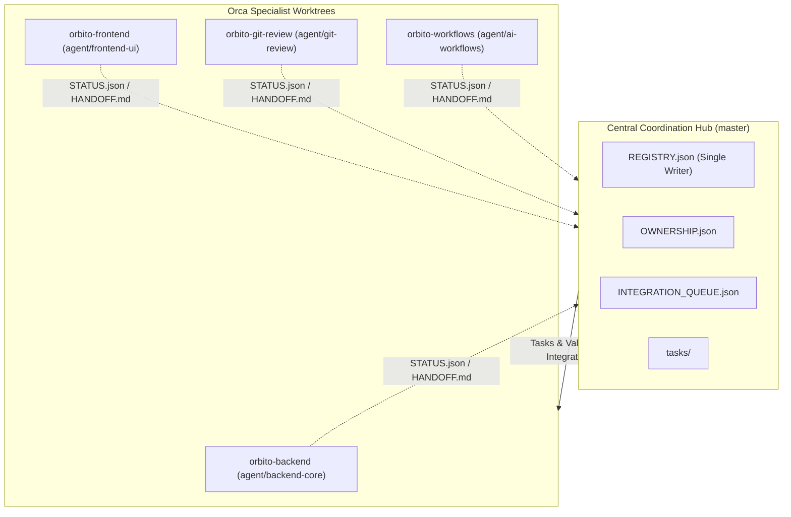

# Orbito Central Multi-Agent Coordination System

**Governance Authority:** Lead Architect
**Architecture:** Shared Git Coordination Hub + Isolated Orca Git Worktrees
**Operating Baseline:** Commit `b9fe0dfcda307258717987f5a09a454ad5e73d62` on `master`

---

## 1. System Architecture

Orbito employs a decentralized execution, centralized coordination model for multi-agent autonomous engineering:



- **Central Hub:** Located at the primary workspace root (`.agents/coordination/`). Serves as the source of truth for repository state, task assignments, and integration gates.
- **Specialist Worktrees:** Completely independent Git worktrees managed via Orca, allowing concurrent development on isolated feature branches without file lock contention or Git index conflicts.

---

## 2. Single Writer Protocol

To prevent race conditions, merge conflicts, and split-brain states in coordination metadata:

1. **Sole Writer Authority:** The **Lead Architect** is the *only* entity authorized to write or modify `REGISTRY.json`.
2. **Specialist Read Access:** Specialists have read-only access to `REGISTRY.json` and `OWNERSHIP.json`.
3. **Specialist Write Scopes:** Specialists write exclusively to:
   - Their own status file: `.agents/coordination/agents/<agent-id>/STATUS.json`
   - Their working notes: `.agents/coordination/agents/<agent-id>/NOTES.md`
   - Their handoff submissions: `.agents/coordination/agents/<agent-id>/HANDOFF.md`
4. **Synchronization Cycle:**
   - Specialists post updates to their local status and handoff files.
   - The Lead Architect reviews, validates, and incorporates these updates into `REGISTRY.json`.

---

## 3. Agent Status & Heartbeat

Every specialist maintains an up-to-date `STATUS.json` adhering to the standard schema:
```json
{
  "agent_id": "backend",
  "worktree": "orbito-backend",
  "branch": "agent/backend-core",
  "status": "IDLE | BUSY | WAITING | BLOCKED | OFFLINE",
  "current_task": "ORB-BACK-001 | null",
  "progress": 0,
  "blockers": [],
  "last_activity": "2026-11-07T19:58:00Z",
  "last_handoff": "2026-11-07T20:30:00Z | null",
  "modified_files": []
}
```

- When starting work: Set `status: "BUSY"`, `current_task: "<TASK_ID>"`.
- When encountering blockers: Set `status: "BLOCKED"`, populate `blockers: ["..."]`.
- When completing work and submitting handoff: Set `status: "WAITING"`.
- When finished / idle: Set `status: "IDLE"`, `current_task: null`.

---

## 4. File Ownership & Cross-Domain Boundaries

Defined strictly in `OWNERSHIP.json`:
- **Backend Specialist:** `src/main/**`, `src/preload/**` (except git & code-review services).
- **Frontend Specialist:** `src/renderer/**` (except review UI components).
- **Git & Review Specialist:** `src/main/services/git/**`, `src/main/services/code-review/**`, `src/renderer/src/components/Review*`.
- **Workflows Specialist:** `.agents/workflows/**`, `.agents/skills/**`, `scripts/ai/**`.
- **Protected Shared Files:** `package.json`, `package-lock.json`, `tsconfig*.json`, `electron.vite.config.ts`, `src/main/db/schema.ts`, `src/shared/**`.
  - **Rule:** Specialists must NEVER modify protected shared files directly. Any required change must be submitted as an ADR proposal to the Lead Architect.

---

## 5. Task Lifecycle

1. **Specification:** Lead Architect creates task file in `tasks/active/<TASK_ID>.json` with explicit `allowed_files` and `forbidden_files`.
2. **Assignment:** Specialist transitions task to `IN_PROGRESS` and updates its `STATUS.json`.
3. **Execution:** Specialist implements the solution strictly adhering to the **Ponytail Simplicity Ladder** and **Anti-Boxiness Rules**.
4. **Local Verification:** Specialist runs `npm run typecheck`, `npm test`, and `npm run validate:structure` within its worktree.
5. **Documentation & Structure Compliance:** Any technical documentation, architecture notes, or audit reports produced must reside in `docs/<category>/` in strict accordance with [Permanent Repository Organisation Policy](../../docs/development/REPOSITORY_ORGANISATION.md) and be linked in `docs/README.md`. Never place markdown files in the repository root.
6. **Handoff:** Specialist fills out `agents/<agent-id>/HANDOFF.md` and transitions status to `WAITING`.
7. **Architect Review:** Lead Architect reviews the diff, validates test outputs, checks structure compliance (`npm run validate:structure`), and evaluates Quality Gates.
8. **Integration & Completion:** Branch is merged into `master`, task is moved to `tasks/completed/`, and `REGISTRY.json` is updated.

---

## 6. Integration Quality Gates

All integrations to `master` must pass sequential gates:
- **Gate 1: Type Integrity:** `npm run typecheck` (0 errors across Node and Web).
- **Gate 2: Automated Testing:** `npm test` (100% passing test suites, zero regressions).
- **Gate 3: Repository Structure Integrity:** `npm run validate:structure` (clean root, zero unapproved files, intact documentation hierarchy).
- **Gate 4: Git Safety:** Clean rebase onto `master`, zero conflict markers, zero cross-domain ownership violations.
- **Gate 5: Architectural Review:** Lead Architect signoff on Ponytail simplicity, security, and clean UX (`npm run validate:coordination`).

---

## 7. Git Safety Rules

1. Never work directly on `master`.
2. Never execute destructive Git commands (`git reset --hard`, `git clean -fd`, `git push --force`).
3. Commit atomically with semantic messages (`feat:`, `fix:`, `refactor:`, `test:`).
4. Never modify files owned by another specialist.
5. Always verify branch state before beginning work:
   ```bash
   git status --short --branch
   git rev-parse HEAD
   ```

---

## 8. Failure Recovery & Operational Protocols

### 8.1 Recovering an Interrupted Task
1. Inspect the agent's worktree: `git status --short` and `git log -1`.
2. Compare modified files against the assigned task's `scope.allowed_files`.
3. If uncommitted changes exist, determine if they represent coherent progress. If so, create a checkpoint commit (`wip: ...`).
4. Read the agent's `NOTES.md` and `STATUS.json` to identify the last known step.
5. Re-run tests (`npm run typecheck`, `npm test`) to determine health.

### 8.2 Handling Disconnected or Stalled Agents
1. If an agent stops responding, check its `STATUS.json` `last_activity` timestamp.
2. If deadlocked or blocked, inspect `blockers` array.
3. If the agent process crashed, Orca or the Lead Architect can re-initialize the specialist by reading its last checkpoint commit and re-invoking the agent with its role definition.

### 8.3 Onboarding a New Specialist
1. Add agent definition to `.agents/agents/roster.json` and create `.agents/agents/<agent-id>.md`.
2. Create dedicated worktree in Orca (`git worktree add <path> <branch>`).
3. Add entry to `.agents/coordination/REGISTRY.json` and `.agents/coordination/OWNERSHIP.json`.
4. Create status folder `.agents/coordination/agents/<agent-id>/` with `STATUS.json`, `HANDOFF.md`, and `NOTES.md`.
5. Run `node scripts/validate-coordination.js` to certify configuration.
