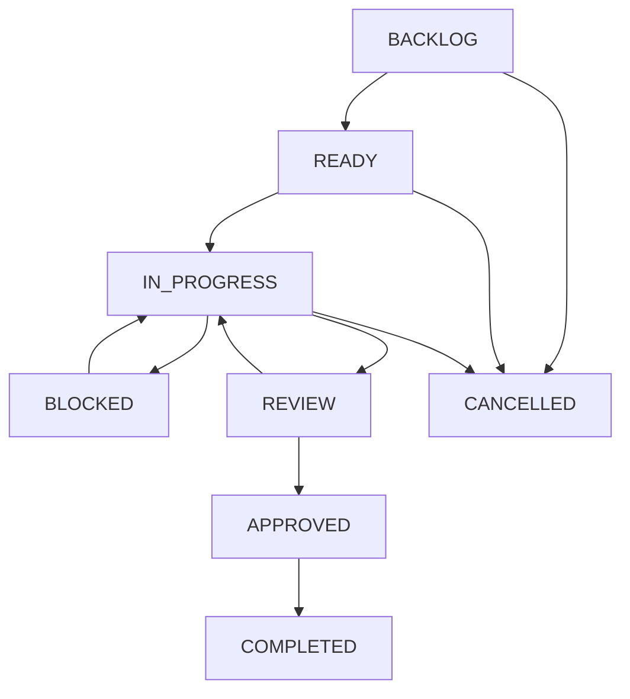

# Orbito Task Management Protocol

## 1. Overview
All development tasks in the Orbito multi-agent environment are formal work units created, assigned, and transitioned under the supervision of the Lead Architect.

## 2. Directory Structure
```text
.agents/coordination/tasks/
├── README.md               # This specification
├── template.json           # Standard task specification template
├── active/                 # Tasks currently IN_PROGRESS or READY
├── blocked/                # Tasks marked BLOCKED awaiting dependencies/unblocking
├── review/                 # Tasks in REVIEW submitted via HANDOFF.md
└── completed/              # Tasks successfully validated and APPROVED / COMPLETED
```

## 3. Task Identifiers
Tasks follow the standard naming convention:
- Backend tasks: `ORB-BACK-###` (e.g., `ORB-BACK-001`)
- Frontend tasks: `ORB-FRONT-###` (e.g., `ORB-FRONT-001`)
- Git & Review tasks: `ORB-GIT-###` (e.g., `ORB-GIT-001`)
- Workflows tasks: `ORB-WF-###` (e.g., `ORB-WF-001`)

## 4. Task Lifecycle & State Transitions



### Transition Rules:
1. **`BACKLOG` → `READY`**: Lead Architect specifies objectives, allowed scope, forbidden files, and dependencies.
2. **`READY` → `IN_PROGRESS`**: Specialist accepts assignment, sets `STATUS.json` (`status: "BUSY"`, `current_task: "ORB-..."`), and begins work in its dedicated worktree.
3. **`IN_PROGRESS` → `BLOCKED`**: Specialist encounters an external impediment, updates `STATUS.json` (`status: "BLOCKED"`, `blockers: [...]`), and moves/flags task.
4. **`IN_PROGRESS` → `REVIEW`**: Specialist completes implementation, passes local tests, fills out `HANDOFF.md`, and updates `STATUS.json` (`status: "WAITING"`).
5. **`REVIEW` → `APPROVED`**: Lead Architect reviews diff, verifies test results against Quality Gates, and validates acceptance criteria.
6. **`APPROVED` → `COMPLETED`**: Code is safely merged into `master`, the task file is moved to `tasks/completed/`, and `REGISTRY.json` is updated.
