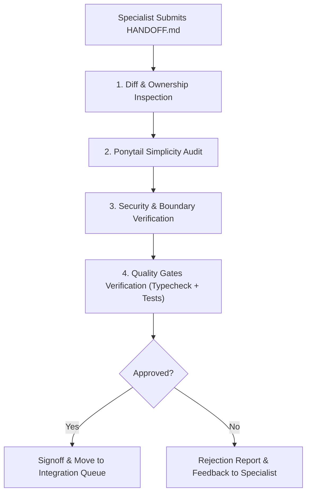

# Workflow: Multi-Agent Code Review

## Purpose
Structured peer review and architectural review protocol conducted before any branch is integrated into `master`.

## Review Roles
- **Lead Architect:** Primary architectural, simplicity, and integration reviewer.
- **Git & Review Specialist:** Automated diff inspection, conflict analysis, and git health validation.
- **Security Specialist / Code Quality Specialist:** Specialized audits for security, IPC sanitization, and SOLID compliance when requested.

## Review Stages

### Stage 1: Diff & Ownership Inspection
- Read the exact diff between the specialist branch and `master`.
- Verify every file modified against `OWNERSHIP.json`.
- Ensure zero accidental commits, temporary files, or unneeded dependencies.

### Stage 2: Ponytail Simplicity Audit
- Check against the Ponytail Ladder:
  1. Could this have been solved with fewer lines?
  2. Was an existing codebase helper reused?
  3. Are there unrequested abstractions (speculative interfaces, redundant wrapper classes)?
  4. Is the change readable by a busy engineer in one pass?

### Stage 3: Security & Boundary Verification
- Check IPC handlers for argument validation and sanitize channel payloads.
- Check file system operations for directory traversal prevention (`path.normalize`, `path.resolve`).
- Verify no credentials, keys, or sensitive configuration leaked.

### Stage 4: Automated Verification
- Run Gate 1: `npm run typecheck`
- Run Gate 2: `npm test`
- Run Gate 3: `node scripts/validate-coordination.js`

### Stage 5: Signoff or Revision Request
- If approved: Record signoff in `.agents/coordination/reviews/` and queue for merge.
- If rejected: Record specific feedback in task comments and reset agent status to `BUSY` for revision.
