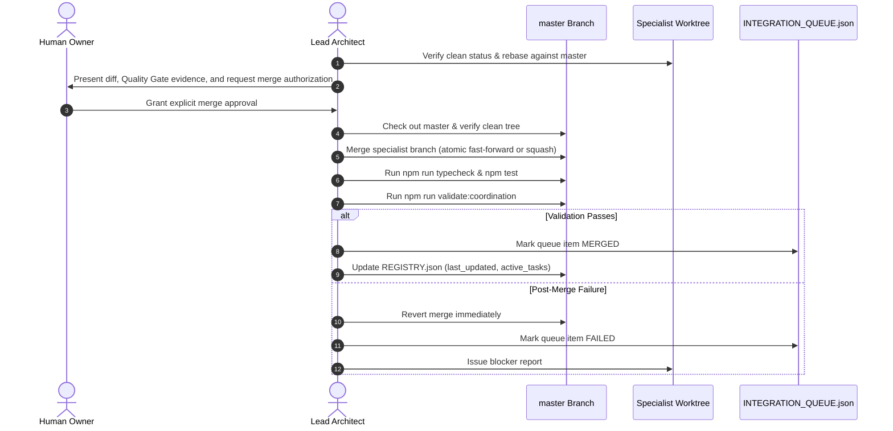

# Workflow: Branch Integration and Merge Protocol

## Purpose
Safe integration protocol for merging verified specialist branches into the `master` integration branch.

## Pre-Integration Prerequisites
An item may only enter the integration sequence if:
1. It is registered in `.agents/coordination/INTEGRATION_QUEUE.json`.
2. It has received full Gate 1–4 signoff in `.agents/workflows/code-review.md`.
3. The specialist branch is fully rebased onto current `master`.
4. **Explicit Human Approval has been granted for the merge.** No automated merges are permitted.

## Integration Execution Steps (Lead Architect with Human Authorization)



### Post-Integration Synchronization
After merging into `master`:
1. The Lead Architect notifies all active specialists to rebase their worktrees onto the new `master` commit:
   ```bash
   git fetch origin master
   git rebase master
   ```
2. The task specification file is moved to `.agents/coordination/tasks/completed/`.
3. The specialist's `STATUS.json` is reset to `IDLE` (`current_task: null`, `progress: 0`).
