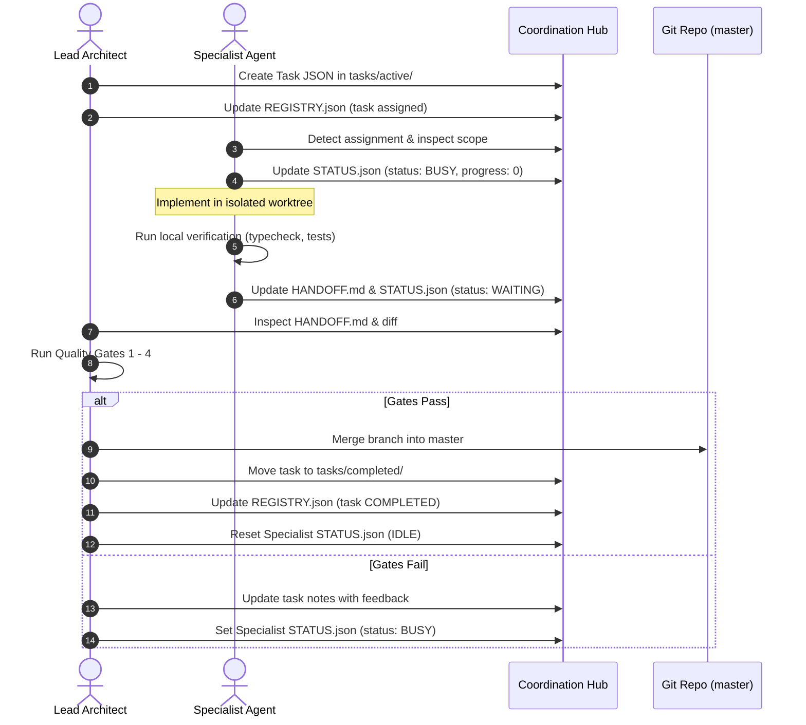

# Workflow: Task Lifecycle Management

## Purpose
Governs the end-to-end progression of tasks from definition to final integration.

## Workflow Steps

### Detailed Phase Actions

### Phase 1: Task Creation (Lead Architect)
1. Verify prerequisite dependencies are satisfied.
2. Generate task ID (e.g. `ORB-BACK-001`).
3. Fill all fields in `tasks/active/<TASK_ID>.json`:
   - Explicit `allowed_files`
   - Explicit `forbidden_files`
   - Specific acceptance criteria & required test commands.
4. Update `REGISTRY.json` `active_tasks` array.

### Phase 2: Specialist Execution (Specialist)
1. Pull / rebase branch on latest `master` if required.
2. Set `STATUS.json`: `status: "BUSY"`, `current_task: "<TASK_ID>"`, `progress: 10`.
3. Implement required code strictly within allowed scope.
4. Periodically update `progress` in `STATUS.json`.
5. Run verification suite: `npm run typecheck && npm test`.

### Phase 3: Handoff Submission (Specialist)
1. Ensure working tree is clean and changes committed atomically.
2. Fill out `.agents/coordination/agents/<agent-id>/HANDOFF.md`.
3. Update `STATUS.json`: `status: "WAITING"`, `progress: 100`, `last_handoff: "<TIMESTAMP>"`.

### Phase 4: Review & Integration (Lead Architect)
1. Execute Quality Gates 1 through 4.
2. If approved, fast-forward or squash merge branch into `master`.
3. Move task file from `tasks/active/` to `tasks/completed/`.
4. Update `REGISTRY.json` to mark task `COMPLETED` and clear active task.
