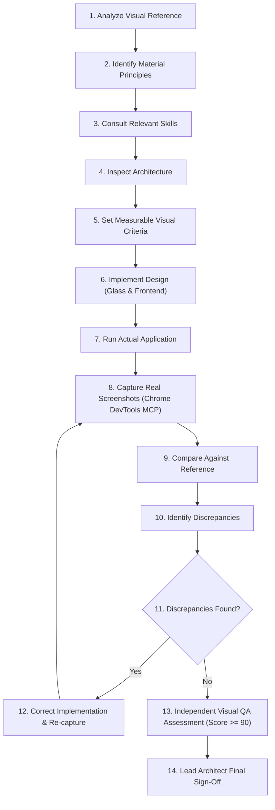

# Visual Engineering Workflow & Protocols

This workflow governs all future visual, material, theme, and UI development in Orbito. It ensures that advanced visual aesthetics—such as Liquid Glass, physical materials, transparent interfaces, and modern frontend design—are implemented with engineering discipline, measurable quality, and zero regression.

---

## 1. Core Rule: Visual Correctness is an Independent Acceptance Criterion

> [!IMPORTANT]
> The agents must NEVER declare visual work complete merely because code compiles, TypeScript passes, or CSS rules have been written. Visual correctness is a distinct, non-negotiable acceptance criterion requiring real rendered evidence.

---

## 2. The 14-Step Visual Engineering Protocol

### Detailed Protocol Steps:
1. **Analyse Requested Visual Reference:** Deconstruct reference mockups, design tokens, optical qualities, lighting directions, and layer composition.
2. **Identify Design Principles & Material Characteristics:** Determine refraction indices, backdrop blur levels, saturation multipliers, specular rim lighting, typography scales, and contrast ratios.
3. **Consult Relevant Design Skills:**
   - For physical glass & refraction: consult `liquid-glass`, `glimmer`, `youmair-glassmorphism`.
   - For UI layout & tokens: consult `liquid-glass-frontend`, `frontend-design`, `youmair-visual-hierarchy`, `youmair-dark-mode-design`, `web-design-guidelines`.
4. **Inspect Existing Application Architecture:** Verify component structure in `src/renderer/`, theme tokens, and anti-boxiness guidelines. Never introduce isolated parallel styling silos.
5. **Establish Measurable Visual Acceptance Criteria:** Document explicit checklist: contrast ratios (>= 4.5:1), border luminosity, blur radii, specular highlight thickness, layout hierarchy, and icon-only toolbar compliance.
6. **Implement Requested Design:**
   - `glass-material-specialist` establishes material formulas, tokens, and SVG displacement filters.
   - `frontend-specialist` integrates materials into React 19 components and Tailwind layout with borderless, anti-boxy hierarchy.
7. **Run the Actual Application:** Start the local Electron or preview environment (`npm run dev` or `electron-vite dev`).
8. **Capture Real Screenshots:** Use `chrome-devtools` MCP server tools (`take_screenshot`, `evaluate_script`) or browser verification harness to capture high-resolution rendered frames across target viewports.
9. **Compare Screenshots Against Original Reference:** Perform side-by-side visual analysis examining layout geometry, optical material fidelity, typographic hierarchy, and color harmony.
10. **Identify Discrepancies:** Isolate pixel misalignments, wrong blur radii, excessive opacity, halation, missing rim highlights, or boxy artifacts.
11. **Correct Implementation:** Specialists modify CSS, SVG filter parameters, or component props to fix identified issues.
12. **Repeat Visual Validation:** Re-run the application and capture updated screenshots to confirm corrections without introducing side regressions.
13. **Independent Visual QA Assessment:** `qa-specialist` independently scores the rendered screenshot across 6 dimensions:
    - Layout accuracy (weight: 0.25)
    - Typography (weight: 0.15)
    - Color accuracy (weight: 0.15)
    - Responsive behavior (weight: 0.15)
    - Interactive states (weight: 0.15)
    - Content completeness (weight: 0.15)
    - Must achieve **PASS** verdict (score >= 90/100). If verdict is **REVISE** (60-89) or **FAIL** (<60), return to Step 11.
14. **Final Sign-Off:** Lead Architect reviews the QA verdict report, typechecks, diffs, and rendered evidence before approving completion.

---

## 3. Team Responsibilities & Wave Coordination

| Role | Primary Specialist | Key Skills Invoked | Assigned Output |
| :--- | :--- | :--- | :--- |
| **Orchestration** | `lead-architect` | `find-skills` | Visual criteria, wave plan, final sign-off |
| **Material Physics** | `glass-material-specialist` | `liquid-glass`, `glimmer`, `youmair-glassmorphism` | SVG filters, rim highlights, glass tokens, blur recipes |
| **UI & Layout** | `frontend-specialist` | `frontend-design`, `liquid-glass-frontend`, `web-design-guidelines` | React 19 components, Tailwind layout, anti-boxiness |
| **Visual QA** | `qa-specialist` | `visual-verdict`, `frontend-visual-qa`, `browser-testing-with-devtools` | Real screenshots, 6-dimension score, PASS verdict |

---

## 4. Anti-Boxiness & Clean Design Rules During Visual Work

1. **No Card Proliferation:** Never enclose every section or metric in rounded rectangular cards with borders.
2. **No Background Pills on Numbers:** Counts and metrics must never have background pill containers (`bg-white/[...]`, `px-1`, `rounded-full`). Render them as clean typographic numbers.
3. **Icon-Only Toolbars:** Toolbar actions and toggles must be strictly icon-only with tooltips (`title` and `aria-label`). Redundant text labels on toolbar buttons are forbidden.
4. **Organic Depth:** Create depth through subtle dark shadow layers and specular rim lighting, not heavy outline borders.
