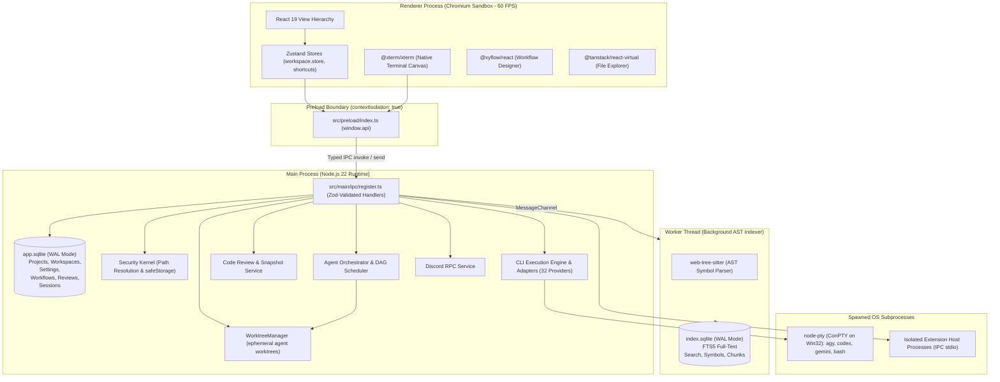
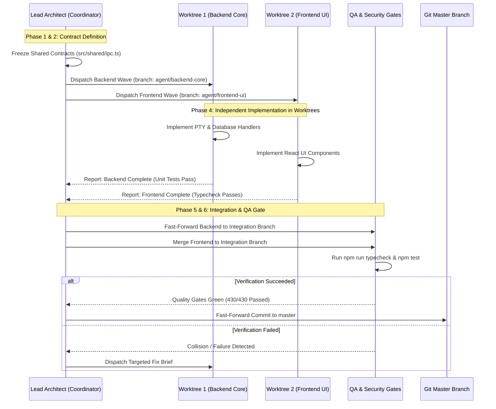

# ORBITO — Full Project Architecture & Multi-Agent Readiness Audit

**Document Version:** 1.0.0  
**Audit Date:** November 7, 2026  
**Auditor Role:** Senior Software Architect, Staff Engineer & DevOps Auditor  
**Classification:** Pre-Worktree Architecture & Multi-Agent Readiness Audit  
**Target Orchestration Environment:** Orca CLI (`v1.4.251`) + Git Worktrees + Antigravity CLI (`agy`) on Windows x64  
**Workspace Root:** `C:\Users\gonca\OneDrive\Documents\Projects\Orbito\Orbito`  

---

## 1. Executive Summary

Orbito (internally registered in `package.json` as `orc-ai-workspace` v0.1.0) is a high-performance, local-first, session-aware desktop application for AI-assisted software engineering. Built on Electron 34, React 19, Node.js 22, SQLite (via `better-sqlite3` and Drizzle ORM), and native PTY terminal execution (`node-pty`), Orbito is engineered to unite local developer command-line workflows with modern AI coding agent orchestration, contextual codebase intelligence (Tree-sitter AST & FTS5 lexical indexing), visual workflow automation, and Git worktree isolation.

This audit was conducted strictly in read-only mode to evaluate the architectural maturity, test stability, security perimeter, and multi-agent parallel development readiness of the codebase.

### Key Audit Findings

1. **System Health & Build Stability:**
   - **Type Checking:** `npm run typecheck` compiles cleanly (`tsc --noEmit -p tsconfig.node.json` and `tsc --noEmit -p tsconfig.web.json` exit with code 0).
   - **Automated Test Suite:** 56 test suites containing 434 tests were executed via the custom Electron test runner (`node scripts/run-electron-tests.js run`). **All 56 test files passed** (430 passing tests, 4 intentionally skipped environment-gated live CLI tests, 0 failures, 73.59s run duration).
   - **Multi-Agent Governance:** The built-in multi-agent system validator (`node scripts/validate-agents.js`) verified 1 orchestrator, 7 primary specialists, 2 optional specialists, 4 rule specifications, and 2 workflow definitions without discrepancies.

2. **Current Git & Workspace Status:**
   - The workspace resides on branch `master` tracking `origin/master` (remote: `https://github.com/ByGONCA/Orbito`).
   - A single active Git worktree exists at `C:/Users/gonca/OneDrive/Documents/Projects/Orbito/Orbito`.
   - **Substantial uncommitted work is present:** 40 modified files (4,260 insertions, 1,733 deletions) and 17 untracked file sets (including `.agents/agents/`, `src/main/terminal/`, `src/renderer/src/components/explorer/`, `src/renderer/src/components/settings/`, and `src/main/services/code-review.service.ts`).
   - *CRITICAL PREREQUISITE:* These working tree modifications must be reviewed, committed, or safely stashed before launching parallel Orca Git Worktrees from `main`/`master`.

3. **External Integrations & Host Environment:**
   - **Orca CLI:** Version `1.4.251` is installed and verified on the host system (`C:\Users\gonca\AppData\Local\Programs\orca\resources\bin\orca.exe`).
   - **Google Antigravity CLI (`agy`):** Installed and operational (`C:\Users\gonca\AppData\Local\agy\bin\agy.EXE`).
   - **OpenAI Codex CLI:** Installed at `C:\Users\gonca\AppData\Local\Programs\OpenAI\Codex\bin\codex.exe`.
   - **Google Gemini CLI:** Installed via npm global packages (`C:\Users\gonca\AppData\Roaming\npm\gemini.cmd`).
   - **Anthropic Claude Code CLI:** Not installed on the system PATH.
   - **Discord Rich Presence:** Fully operational via `@xhayper/discord-rpc` with zero-config application ID `1305267026857103440`.

4. **Multi-Agent Worktree Readiness Verdict:**
   - **HIGH SUITABILITY.** Orbito has a decoupled 3-tier process model (Renderer Process, Main Electron Process, and Subprocesses/Worker Threads).
   - Furthermore, the repository already contains a native `WorktreeManager` class (`src/main/agents/worktree-manager.ts`) and a formal multi-agent roster in `.agents/agents/roster.json`.
   - Parallel agent development using Orca Worktrees can be safely deployed across **4 specialized worktrees** with zero overlap on core business logic, provided strict ownership boundaries are enforced.

---

## 2. Project Overview

### 2.1 Purpose & Target Audience
Orbito is designed for professional software engineers, technical leads, and AI researchers who require an integrated, local-first cockpit for AI-assisted engineering. Rather than treating AI as an isolated chat interface or a web-only cloud service, Orbito embeds autonomous CLI agents directly into native interactive terminals (`node-pty` + `xterm.js`), indexes local code repositories into a fast offline SQLite graph database, visualizes execution diffs and code review comments, and provides an extensible visual canvas (`@xyflow/react`) for multi-step AI workflow orchestration.

### 2.2 Current Development Stage
- **Phase Status:** Phases 1 through 7 (Core Architecture, Project Management, Context Engine, Persistent Workspace, Multi-Agent Orchestrator, Visual Workflows, Extension SDK & Enterprise Hardening) are implemented.
- **Active Transition:** Transitioning from single-developer prototype to a production-grade multi-agent collaborative engineering platform orchestrated via Orca and Git Worktrees.

### 2.3 Main Application Features
1. **Interactive Multi-Agent Terminal Matrix:** Run up to 4 concurrent native PTY sessions (Claude Code, OpenAI Codex, Google Gemini, Ollama, Google Antigravity, and 27 additional community agents) with ANSI streaming, WebGL acceleration, and tab-pane snapping.
2. **Offline Hybrid Context Indexer:** Tree-sitter AST parsing (`web-tree-sitter`) paired with SQLite FTS5 lexical full-text search (`index.sqlite`) and BM25 token ranking for zero-cloud symbol lookup.
3. **Changes & Code Review Suite:** Automated git diff capture before and after AI agent runs, line-by-line diff hunks, inline review commenting, and AI-assisted code review (`code-review.service.ts`).
4. **Visual Flow Builder:** Drag-and-drop workflow canvas (`@xyflow/react`) allowing users to assemble linear or branched pipelines of AI prompt nodes, bash execution nodes, and custom extension nodes.
5. **Multi-Tier Memory & Air-Gap Security:** Encrypted local credential storage (`safeStorage`), configurable air-gap network barriers, and process-level extension isolation.
6. **Discord Rich Presence Integration:** Real-time IDE status broadcast displaying active project name, git branch, and execution state.

### 2.4 Core Architectural Principles
- **Local-First & Privacy-Centric:** All state, vector/lexical indexes, workflow definitions, and credentials reside on the developer's local filesystem (`.ai-workspace-data` or `%APPDATA%\Orc AI Workspace`).
- **Strict Process Boundaries:** Zero raw Node.js or Electron API access in the Chromium renderer. All operations route through strongly-typed IPC contracts validated via Zod schemas.
- **Ponytail Simplicity Ladder:** YAGNI, standard library first, reuse existing components, and minimal working diffs.
- **Anti-Boxiness & Clean Typography:** UI philosophy eliminating container proliferation, nested card borders, and pill backgrounds around numbers and badges.

---

## 3. Technology Stack

Verified from `package.json`, `package-lock.json`, and source code references:

| Technology | Version | Purpose | Evidence |
|---|---|---|---|
| **Electron** | `34.5.8` | Cross-platform desktop runtime host (Chromium + Node.js) | `package.json#L52`, `src/main/index.ts#L4` |
| **Node.js** | `v22.x` (target) | Main process execution environment | `package.json#L46` (`@types/node: ^22.10.2`) |
| **TypeScript** | `5.7.2` | Static typing and language analysis across all processes | `package.json#L56`, `tsconfig.json` |
| **React** | `19.0.0` | UI component library (client-side SPA renderer) | `package.json#L35`, `src/renderer/src/App.tsx#L1` |
| **React DOM** | `19.0.0` | DOM rendering and reconciliation | `package.json#L36` |
| **Vite** | `6.4.5` | Fast frontend bundling and dev server | `package.json#L57` |
| **electron-vite** | `6.0.0` | Multi-target build orchestration (main, preload, renderer) | `package.json#L53`, `electron.vite.config.ts` |
| **better-sqlite3** | `11.8.0` | Native synchronous SQLite binding for Electron ABI 132 | `package.json#L28`, `src/main/db/database.service.ts#L1` |
| **Drizzle ORM** | `0.38.3` | Type-safe SQL schema definition and query modeling | `package.json#L31`, `drizzle-kit: 0.30.1` |
| **node-pty** | `1.1.0` | Native pseudo-terminal subprocess spawning (ConPTY on Win32) | `package.json#L34`, `src/main/terminal/pty-service.ts#L5` |
| **@xterm/xterm** | `6.0.0` | Terminal emulator rendering in the React frontend | `package.json#L26`, `src/renderer/src/components/NativeTerminal.tsx#L3` |
| **@xterm/addon-fit** | `0.11.0` | Auto-resizing xterm viewport geometry to container bounds | `package.json#L24` |
| **@xterm/addon-web-links** | `0.12.0` | Clickable hyperlink detection in terminal output | `package.json#L25` |
| **Zustand** | `5.0.3` | Lightweight client-side reactive state management | `package.json#L41`, `src/renderer/src/stores/workspace.store.ts#L1` |
| **Zod** | `3.24.1` | Runtime validation for IPC channel payloads and schemas | `package.json#L40`, `src/shared/ipc.ts#L1` |
| **Tailwind CSS** | `3.4.17` | Utility-first CSS framework with custom design tokens | `package.json#L55`, `tailwind.config.js` |
| **@xyflow/react** | `12.12.1` | Node-based visual graph canvas for Workflow Designer | `package.json#L27`, `src/renderer/src/components/FlowBuilder/` |
| **@tanstack/react-virtual** | `3.11.2` | DOM virtualization for large file trees and log streams | `package.json#L22` |
| **web-tree-sitter** | `0.22.6` | WebAssembly Tree-sitter AST parser for multi-language code | `package.json#L39`, `src/main/context/ast-parser.service.ts` |
| **js-tiktoken** | `1.0.21` | Fast local tokenizer for token counting and prompt budgeting | `package.json#L32`, `src/main/prompt/token-counter.service.ts` |
| **@xhayper/discord-rpc** | `1.5.1` | Discord Rich Presence client over local named pipes | `package.json#L23`, `src/main/services/discord/discord-rpc.service.ts#L1` |
| **Vitest** | `3.2.0` | Unit and integration test runner | `package.json#L58`, `vitest.config.ts` |
| **@electron/rebuild** | `4.2.1` | Native C++ module rebuild against Electron headers | `package.json#L44`, `package.json#L15` |
| **Orca CLI** | `1.4.251` | Orchestration CLI, worktree manager, and automation runner | Verified via `orca --version` on host PATH |
| **Antigravity CLI (`agy`)** | Installed | Autonomous agent CLI by Google DeepMind | Verified at `C:\Users\gonca\AppData\Local\agy\bin\agy.EXE` |

---

## 4. Architecture Analysis

Orbito employs a strict multi-boundary, process-isolated architecture designed to avoid UI freezes during heavy AST indexing or terminal streaming while preventing malicious code execution from compromising the host system.

### 4.1 Process Boundaries



### 4.2 Application Layers & Module Breakdown

1. **Presentation Layer (`src/renderer/`):**
   - **`App.tsx`:** Root component managing window layout, resize handles, command palette, and detached tab windows (`DetachedTabWindow.tsx`).
   - **`src/renderer/src/components/`:** Functional UI views including `LeftSidebar.tsx`, `TopTabBar.tsx`, `CenterArea.tsx`, `RightPanel.tsx`, `BottomPanel.tsx`, `NativeTerminal.tsx`, `CodeEditor.tsx`, `ProjectsWorkspace.tsx`, and `ArcLauncherModal.tsx`.
   - **`src/renderer/src/stores/`:** Reactive Zustand stores:
     - `workspace.store.ts`: 2,175 lines managing projects, active tabs, open terminals, layout splits, git status, review states, and CLI statuses.
     - `keyboard-shortcuts.store.ts`: Configurable hotkey dispatch table.

2. **IPC & Preload Bridge Layer (`src/preload/`, `src/shared/`):**
   - **`src/preload/index.ts`:** Exposes `window.api` strictly via `contextBridge.exposeInMainWorld`. No raw Electron or Node APIs are leaked.
   - **`src/shared/ipc.ts`:** 653 lines declaring typed request/response contracts and Zod schemas for all 60+ IPC channels.
   - **`src/shared/cli.ts`:** Types and schemas for CLI providers, session statuses, and PTY lifecycle.
   - **`src/shared/review.ts`:** Schemas for code reviews, file changes, diffs, and inline review comments.

3. **Backend & Service Layer (`src/main/`):**
   - **`src/main/index.ts`:** Application bootstrap, single-instance mutex (`requestSingleInstanceLock`), Content Security Policy (CSP), air-gap request interception, and graceful shutdown handlers.
   - **`src/main/db/database.service.ts`:** 3,143 lines encapsulating `better-sqlite3`. Manages dual databases (`app.sqlite` and `index.sqlite`) with WAL mode, 32MB cache limits, and automatic startup schema migrations.
   - **`src/main/terminal/pty-service.ts`:** Manages native `node-pty` terminal instances, session reuse, ANSI data broadcasting, and auto-resizing.
   - **`src/main/cli/cli-manager.ts`:** Registry managing 32 CLI provider adapters (Antigravity, Claude Code, Codex, Gemini, Ollama, Aider, Cursor, Goose, etc.).
   - **`src/main/services/project-execution.service.ts`:** Takes pre-execution workspace snapshots, monitors file modifications made by AI agents, and computes unified diffs.
   - **`src/main/services/code-review.service.ts`:** Persists code review decisions (`approved`, `changes_requested`), line comments, and automated AI review findings.
   - **`src/main/agents/worktree-manager.ts`:** Safe execution of Git commands via `child_process.execFile`. Spawns isolated Git worktrees in `.worktrees/wt-<taskId>` and computes change sets without altering the primary working directory.
   - **`src/main/services/discord/discord-rpc.service.ts`:** Discord Rich Presence daemon displaying project details and idle/coding activity.

---

## 5. Feature Inventory

| Feature | Status | Main Files | Dependencies | Notes |
|---|---|---|---|---|
| **Multi-Terminal Workspace** | **Implemented** | `src/renderer/src/components/NativeTerminal.tsx`, `src/main/terminal/pty-service.ts` | `node-pty`, `@xterm/xterm`, `@xterm/addon-fit` | Fully functional PTY with ConPTY on Windows, split views (1, 2-col, 2-row, 3-split, 4-grid). |
| **Dual SQLite Persistence** | **Implemented** | `src/main/db/database.service.ts` | `better-sqlite3`, `drizzle-orm` | Split architecture: `app.sqlite` (app data) and `index.sqlite` (FTS5 search). |
| **CLI Agent Adapters (32 targets)** | **Implemented** | `src/main/cli/cli-manager.ts`, `src/main/cli/adapters/*.ts` | Node.js `child_process`, `fs` | Complete adapters for Antigravity, Claude Code, Codex, Gemini, Ollama, and 27 others. |
| **Git Worktree Manager** | **Implemented** | `src/main/agents/worktree-manager.ts` | Git CLI, `child_process` | Creates ephemeral worktrees in `.worktrees/`, diff calculation, and conflict checking. |
| **Code Review & Changes View** | **Implemented** | `src/main/services/code-review.service.ts`, `src/renderer/src/components/explorer/ChangesView.tsx` | Git CLI, SQLite | Pre/post execution snapshots, line-level comments, diff inspection, review statuses. |
| **Code Editor & Tabs** | **Implemented** | `src/renderer/src/components/CodeEditor.tsx`, `src/renderer/src/components/TopTabBar.tsx` | React 19, Lucide icons | Syntax-aware editor with unsaved changes tracking, detached tab windows. |
| **Offline AST & Lexical Indexer** | **Implemented** | `src/main/context/ast-parser.service.ts`, `context-indexer.service.ts` | `web-tree-sitter`, SQLite FTS5 | Generates AST symbol tables and chunked lexical indexes in worker threads. |
| **Multi-Agent Orchestrator (DAG)**| **Implemented** | `src/main/agents/agent-orchestrator.ts`, `agent-scheduler.ts` | SQLite, WorktreeManager | Supports multi-step agent plans, dependency DAG validation, and human approval gates. |
| **Visual Workflow Designer** | **Implemented** | `src/renderer/src/components/FlowBuilder/`, `src/main/workflows/` | `@xyflow/react`, SQLite | Interactive node-based pipeline builder with execution engine and pre-built templates. |
| **Extension SDK & Host Sandbox**| **Implemented** | `src/main/extensions/extension-host.manager.ts`, `extension-registry.ts` | Node `child_process`, OS sandboxing | Subprocess-isolated plugins with granular capability permissions. |
| **Air-Gap Network Isolation** | **Implemented** | `src/main/services/air-gap.manager.ts`, `src/main/index.ts#L229` | Electron `session.webRequest` | Blocks outbound HTTP/TCP requests when active; allows only localhost. |
| **Discord Rich Presence** | **Implemented** | `src/main/services/discord/discord-rpc.service.ts` | `@xhayper/discord-rpc` | Displays active project name, repository, branch, and status badges. |
| **Arc Launcher / Command Palette**| **Implemented** | `src/renderer/src/components/ArcLauncherModal.tsx`, `CommandPalette.tsx` | Zustand, Lucide | Global shortcut modal (`Ctrl+K` / `Ctrl+Shift+P`) for rapid action dispatch. |
| **Multi-Agent Roster Governance**| **Implemented** | `.agents/agents/roster.json`, `scripts/validate-agents.js` | Node.js | Validates agent definitions, capabilities, and separation of concerns. |

---

## 6. External Integrations

Orbito interacts with external tools, CLIs, and local operating system resources:

| Integration Target | Implementation Location | Authentication / Configuration | Operational Status | Security Implications |
|---|---|---|---|---|
| **Orca CLI** | System PATH (`orca.exe`) | CLI session / local IPC | **Operational** (v1.4.251 verified on host) | High privilege: can orchestrate worktrees, terminals, and automations. |
| **Google Antigravity (`agy`)** | `src/main/cli/adapters/antigravity.adapter.ts` | `ANTIGRAVITY_API_KEY`, `GEMINI_API_KEY`, or `agy auth` | **Operational** (Executable present at `Local\agy\bin\agy.EXE`) | Spawns agent processes; requires path validation and boundary check. |
| **OpenAI Codex CLI** | `src/main/cli/adapters/codex.adapter.ts` | `OPENAI_API_KEY` or `~/.codex/config.json` | **Operational** (Executable present at `Programs\OpenAI\Codex\bin\codex.exe`) | Executes interactive agent with file-modification permissions. |
| **Google Gemini CLI** | `src/main/cli/adapters/gemini.adapter.ts` | `GEMINI_API_KEY` in environment | **Operational** (npm global binary at `Roaming\npm\gemini.cmd`) | Network outbound requests to Google API endpoints. |
| **Anthropic Claude Code** | `src/main/cli/adapters/claude-code.adapter.ts` | `ANTHROPIC_API_KEY` or `~/.claude.json` | **Supported (Not Installed)** | Adapter ready; will prompt user with install command if selected. |
| **Local Git Executable** | `src/main/agents/worktree-manager.ts`, `git-remote-resolver.ts` | Local user Git config / SSH keys | **Operational** | Uses `execFile` with array arguments to prevent shell injection. |
| **Discord Rich Presence** | `src/main/services/discord/discord-rpc.service.ts` | Local named pipes (IPC socket `discord-ipc-0`) | **Operational** | Local IPC only; does not send codebase content or secrets to Discord. |
| **Local SQLite Filesystem** | `src/main/db/database.service.ts` | File-level read/write permissions | **Operational** | Dual databases stored in `.ai-workspace-data` or `%APPDATA%`. |
| **Tree-sitter WASM Engine** | `src/main/context/ast-parser.service.ts` | Local WASM binaries in `tree-sitter-wasms` | **Operational** | Memory-contained WebAssembly; zero network activity. |

---

## 7. Git & Development Environment Audit

A comprehensive read-only inspection of the repository's Git state was executed:

- **Repository Root:** `C:\Users\gonca\OneDrive\Documents\Projects\Orbito\Orbito`
- **Active Branch:** `master`
- **Remote Configuration:**
  - `origin`: `https://github.com/ByGONCA/Orbito` (fetch & push)
  - Remote tracking: `origin/master` (HEAD), `origin/main`
- **Existing Git Worktrees:**
  ```
  C:/Users/gonca/OneDrive/Documents/Projects/Orbito/Orbito c1ff866 [master]
  ```
  *(Only 1 worktree currently registered; no secondary worktrees active.)*
- **Merge Conflicts:** None.
- **Recent Git Log:**
  - `c1ff866` (HEAD -> master, origin/master): *fix(terminals): attach tab bar directly to terminal panes with top-tab styling and remove top duplication*
  - `a4e630b`: *chore: remove test_png.png*
  - `f1d7e4e`: *feat(discord): add status badges, dynamic repository button, and card layout matching reference*
  - `1d77351`: *feat(discord): set official Orbito Application ID as default for zero-config rich presence*
  - `13b5996`: *fix(discord): sync active project to rpc and load official orbito logo directly*

### Working Tree State (Uncommitted Changes)

The working tree currently contains 40 modified files and 17 untracked file sets. Key modified areas:
- **Terminal & PTY:** `TerminalWorkspace.tsx` (+1920 lines), `src/main/terminal/pty-service.ts`, `src/renderer/src/components/NativeTerminal.tsx`.
- **Database & Services:** `database.service.ts` (+432 lines), `code-review.service.ts`, `project-execution.service.ts`.
- **UI & Layout:** `App.tsx`, `RightPanel.tsx`, `SettingsModal.tsx`, `workspace.store.ts` (+453 lines).
- **Multi-Agent Roster:** `.agents/agents/` (12 files), `.agents/rules/multi-agent-system.md`, `scripts/validate-agents.js`.

> [!IMPORTANT]
> **Pre-Worktree Baseline Commit Required:**
> Because Git Worktrees branch from committed history (or a specified branch/commit), any changes lingering uncommitted in the main working tree will **NOT** be visible inside newly created worktrees. Before creating specialist worktrees in Orca, this working tree must be committed or stashed to establish a clean baseline.

---

## 8. Multi-Agent Worktree Readiness

Evaluating the codebase against the requirements for parallel multi-agent development using Git Worktrees:

### 8.1 Domain Decomposition & Suitability Assessment

The architecture cleanly divides into 4 primary functional domains and 2 supporting verification domains:

```
┌────────────────────────────────────────────────────────────────────────┐
│                        DOMAIN DECOMPOSITION                            │
├──────────────────────────┬──────────────────────────┬──────────────────┤
│ Domain 1: Frontend & UI  │ Domain 2: Backend & Svc  │ Domain 3: Git &  │
│                          │                          │ Review Workflow  │
│ - src/renderer/          │ - src/main/              │ - src/main/ag... │
│ - React 19 components    │ - IPC handlers           │ - WorktreeMgr    │
│ - Zustand stores         │ - SQLite persistence     │ - ReviewService  │
│ - Tailwind & CSS styling │ - PTY & CLI adapters     │ - ChangesView    │
├──────────────────────────┼──────────────────────────┴──────────────────┤
│ Domain 4: AI & Workflows │ Verification: QA & Security (Non-Worktree)   │
│                          │                                              │
│ - FlowBuilder canvas     │ - Vitest automated test suite verification   │
│ - AST indexer / Context  │ - Sandboxing & IPC security auditing         │
│ - Agent orchestrator     │ - Ponytail simplicity & DRY review           │
└──────────────────────────┴──────────────────────────────────────────────┘
```

1. **Frontend & UI (`frontend-specialist`):**
   - **Scope:** `src/renderer/src/components/`, `src/renderer/src/stores/`, `src/renderer/src/index.css`.
   - **Independence:** High. Communicates with backend solely through `window.api` IPC contracts in `src/shared/ipc.ts`.
   - **Worktree Justification:** Dedicated Worktree (`agent/frontend-ui`).

2. **Backend Services & CLI Engine (`backend-specialist`):**
   - **Scope:** `src/main/terminal/`, `src/main/cli/`, `src/main/db/`, `src/main/ipc/`.
   - **Independence:** High. Encapsulates Node.js execution, SQLite queries, and native PTY lifecycle.
   - **Worktree Justification:** Dedicated Worktree (`agent/backend-core`).

3. **Git Integration, Worktrees & Code Review (`git-specialist`):**
   - **Scope:** `src/main/agents/worktree-manager.ts`, `src/main/services/code-review.service.ts`, `src/renderer/src/components/explorer/ChangesView.tsx`.
   - **Independence:** Moderate. Intersects with project execution snapshots.
   - **Worktree Justification:** Dedicated Worktree (`agent/git-review`).

4. **Visual Workflows & Intelligence Context (`ai-workflow-specialist`):**
   - **Scope:** `src/renderer/src/components/FlowBuilder/`, `src/main/workflows/`, `src/main/context/`.
   - **Independence:** High. Modular canvas and AST indexing logic.
   - **Worktree Justification:** Dedicated Worktree (`agent/ai-workflows`).

5. **QA, Security & Architecture (Orchestrator Level):**
   - `qa-specialist`, `security-specialist`, and `code-quality-specialist` do not require isolated long-lived worktrees; they inspect diffs and run validation suites against the integrated branches.

---

## 9. File Conflict Analysis

When multiple agents work simultaneously on independent Git worktrees, certain shared files present collision risks during merge:

### Conflict Matrix

| File / Directory | Potential Agents | Conflict Risk | Recommended Single Owner | Rationale & Protection Rule |
|---|---|---|---|---|
| `package.json` & `package-lock.json` | All Specialists | **HIGH** | `backend-specialist` | Dependency changes must be centralized. Specialists request dependencies via Lead Architect. |
| `src/shared/ipc.ts` | Frontend, Backend, Git | **HIGH** | `backend-specialist` (or Lead Architect) | IPC contracts define the boundary interface. Changes must follow a contract-first design protocol. |
| `src/preload/index.ts` | Frontend, Backend | **MEDIUM** | `backend-specialist` | Implements the typed contextBridge mapping for `src/shared/ipc.ts`. |
| `src/renderer/src/stores/workspace.store.ts` | Frontend, Git | **HIGH** | `frontend-specialist` | Very large file (2,175 lines). Must not be modified simultaneously by multiple agents. |
| `src/main/db/database.service.ts` | Backend, Git, Workflows | **HIGH** | `backend-specialist` | Database schema migrations and table definitions must be strictly sequenced. |
| `src/renderer/src/App.tsx` | Frontend | **LOW** | `frontend-specialist` | Root UI container; exclusively owned by Frontend. |
| `src/main/index.ts` | Backend | **LOW** | `backend-specialist` | Electron main process bootstrap. |
| `AGENTS.md` & `.agents/` | Lead Architect | **CRITICAL** | `lead-architect` | System rules and roster must never be edited by uncoordinated specialists. |
| `src/shared/types.ts` & `review.ts` | Backend, Frontend | **MEDIUM** | `backend-specialist` | Shared type declarations. Contract updates precede implementation. |

---

## 10. Security Audit

A thorough evaluation of Orbito's security architecture reveals robust defensive engineering across process boundaries:

1. **Chromium Process Isolation & Sandboxing:**
   - In `src/main/index.ts#L48-L50`, all browser windows enforce `sandbox: true`, `contextIsolation: true`, and `nodeIntegration: false`.
   - No direct access to `require`, `fs`, `child_process`, or Node.js globals exists inside the renderer.

2. **IPC Payload Validation:**
   - Every IPC handler in `src/main/ipc/register.ts` validates incoming arguments using Zod schemas (`TerminalCreateSchema.parse(args)`, `SaveFileSchema.parse(args)`, etc.). Malformed payloads throw immediate validation errors before executing business logic.

3. **Filesystem Path Containment:**
   - `src/main/services/security.service.ts` and `src/main/services/workspace.service.ts` validate that all file operations resolve within allowed project boundaries, preventing directory traversal attacks (`../`).
   - Covered by 16 adversarial unit tests in `tests/filesystem-security-adversarial.test.ts`.

4. **Subprocess Execution Safety:**
   - PTY and CLI invocations (`pty-service.ts`, `execution-engine.ts`, `worktree-manager.ts`) use `node-pty.spawn` or `execFile` with argument arrays. Raw shell string interpolation (`exec(...)`) is avoided, eliminating shell injection vectors.

5. **Secrets & Credentials Storage:**
   - Sensitive keys are protected using Electron's `safeStorage` API (`safe-storage.service.ts`), leveraging Windows DPAPI (Data Protection API) for encrypted persistence on disk. Plaintext storage is forbidden.

6. **Air-Gap Network Barrier:**
   - `session.defaultSession.webRequest.onBeforeRequest` in `src/main/index.ts#L229` dynamically cancels outbound HTTP/WebSocket requests when Air-Gap mode is toggled, permitting only loopback connections (`127.0.0.1`, `localhost`).
   - Validated by 7 tests in `tests/air-gap-manager.test.ts`.

7. **Discord RPC Privacy:**
   - `discord-rpc.service.ts` broadcasts only the project name, branch, and general editor status. No file paths, code contents, or API credentials are leaked over the RPC pipe.

---

## 11. Testing & Quality Assessment

### 11.1 Test Suite Inventory
The test suite is powered by Vitest 3.2.0 executed inside an Electron-compatible environment via `scripts/run-electron-tests.js`:

- **Total Test Files:** 56 suites
- **Total Tests:** 434 tests (430 passing, 4 skipped environment-gated live CLI tests, 0 failures)
- **Suite Execution Time:** 73.59 seconds
- **Key Test Categories:**
  - *Extension Sandboxing & OS Isolation:* `tests/extension-os-sandboxing.test.ts` (13 tests), `extension-security-isolation.test.ts` (9 tests).
  - *PTY Terminal & CLI Adapters:* `tests/pty-terminal.test.ts` (6 tests), `tests/adapters/*.test.ts` (45 tests).
  - *Filesystem & Path Security:* `tests/filesystem-security-adversarial.test.ts` (16 tests), `security-kernel.test.ts` (6 tests).
  - *Context, AST & Search:* `tests/context-ast-parser.test.ts` (4 tests), `context-hybrid-search.test.ts` (3 tests), `context-indexer.test.ts`.
  - *Project Explorer & Code Review:* `tests/project-explorer.test.ts` (10 tests), `project-centric-architecture.test.ts` (12 tests).
  - *Multi-Agent Orchestration & DAG:* `tests/agents-dag-validator.test.ts` (6 tests), `agents-scheduler.test.ts` (3 tests), `agents-worktree-manager.test.ts` (3 tests).
  - *Performance Benchmarks:* `tests/performance-production-audit.test.ts` (3 tests — verified safe expression evaluation at 156,273 ops/sec and air-gap checks at 1,056,106 checks/sec).

### 11.2 Quality Gates & Multi-Agent Verification Workflow
For a parallel multi-agent environment, the following quality gates must be executed prior to any branch integration:

1. **Compilation Gate:** `npm run typecheck` (Node and Web tsconfig checks must exit 0).
2. **Roster Validation Gate:** `node scripts/validate-agents.js` (Multi-agent configuration integrity).
3. **Automated Test Gate:** `node scripts/run-electron-tests.js run <changed-test-file>` (Targeted test verification during development), followed by `npm test` before merge.

---

## 12. Recommended Worktree Architecture & Orca Notes

Based on verified architectural boundaries, we recommend **4 dedicated Git Worktrees**, each mapped to a specialized Antigravity agent.

### Worktree Allocation Table

| Worktree Name | Git Branch | Specialist Agent | Scope & Exclusively Assigned Directories |
|---|---|---|---|
| `orbito-frontend` | `agent/frontend-ui` | `frontend-specialist` | `src/renderer/src/components/`, `src/renderer/src/stores/`, `src/renderer/src/index.css` |
| `orbito-backend` | `agent/backend-core` | `backend-specialist` | `src/main/terminal/`, `src/main/cli/`, `src/main/db/`, `src/main/ipc/`, `src/main/index.ts` |
| `orbito-git-review` | `agent/git-review` | `git-specialist` | `src/main/agents/worktree-manager.ts`, `src/main/services/code-review.service.ts`, `src/main/services/project-execution.service.ts`, `src/renderer/src/components/explorer/` |
| `orbito-workflows` | `agent/ai-workflows` | `research-specialist` / `backend-specialist` | `src/renderer/src/components/FlowBuilder/`, `src/main/workflows/`, `src/main/context/` |

---

### Ready-to-Copy Orca Notes

#### Orca Note 1: Frontend Specialist
```markdown
# Orca Note — Agent Launch Specification: Frontend Specialist

- **Project:** Orbito
- **Run on:** Local Windows
- **Create From:** main (or master after committing baseline)
- **Branch:** agent/frontend-ui
- **Agent:** Antigravity (CLI)
- **Parent worktree:** No parent
- **Sparse checkout:** Full checkout

### Specialist Directive:
You are the **frontend-specialist** for Orbito.
Your mission is to maintain and enhance the React 19 UI, Tailwind CSS styling, and Zustand stores.

### Assigned Exclusively:
- `src/renderer/src/components/` (excluding `explorer/` and `FlowBuilder/`)
- `src/renderer/src/stores/workspace.store.ts`
- `src/renderer/src/stores/keyboard-shortcuts.store.ts`
- `src/renderer/src/index.css`

### Strict Guidelines:
1. Adhere to Anti-Boxiness Principles: no container proliferation, no pill backgrounds around counts or numbers, clean borderless typography.
2. Adhere to Ponytail Simplicity: reuse existing components from `src/renderer/src/components/ui/`.
3. Never modify `src/shared/ipc.ts` or `src/main/` without coordinating with the Lead Architect.
4. Run `npx tsc --noEmit -p tsconfig.web.json` to verify compilation before reporting completion.
```

#### Orca Note 2: Backend Specialist
```markdown
# Orca Note — Agent Launch Specification: Backend Specialist

- **Project:** Orbito
- **Run on:** Local Windows
- **Create From:** main (or master after committing baseline)
- **Branch:** agent/backend-core
- **Agent:** Antigravity (CLI)
- **Parent worktree:** No parent
- **Sparse checkout:** Full checkout

### Specialist Directive:
You are the **backend-specialist** for Orbito.
Your mission is to maintain and enhance Electron main process services, IPC handlers, SQLite persistence (`better-sqlite3`), and native PTY terminal execution.

### Assigned Exclusively:
- `src/main/terminal/` (`pty-service.ts`)
- `src/main/cli/` (`cli-manager.ts`, `adapters/`, `base.adapter.ts`)
- `src/main/db/` (`database.service.ts`)
- `src/main/ipc/` (`register.ts`)
- `src/preload/index.ts`
- `src/shared/ipc.ts`, `src/shared/cli.ts`

### Strict Guidelines:
1. Strict IPC security: always validate arguments with Zod schemas.
2. Subprocess safety: invoke processes with argument arrays; never interpolate raw shell strings.
3. Database changes: maintain WAL mode and avoid blocking the event loop.
4. Run `npx tsc --noEmit -p tsconfig.node.json` and `node scripts/run-electron-tests.js run tests/pty-terminal.test.ts` to verify changes.
```

#### Orca Note 3: Git & Code Review Specialist
```markdown
# Orca Note — Agent Launch Specification: Git & Review Specialist

- **Project:** Orbito
- **Run on:** Local Windows
- **Create From:** main (or master after committing baseline)
- **Branch:** agent/git-review
- **Agent:** Antigravity (CLI)
- **Parent worktree:** No parent
- **Sparse checkout:** Full checkout

### Specialist Directive:
You are the **git-specialist** for Orbito.
Your mission is to optimize Git worktree management, pre/post execution snapshot tracking, and the visual Code Review system.

### Assigned Exclusively:
- `src/main/agents/worktree-manager.ts`
- `src/main/services/code-review.service.ts`
- `src/main/services/project-execution.service.ts`
- `src/renderer/src/components/explorer/` (`ChangesView.tsx`, `CodeReviewModal.tsx`, `InlineDiffViewer.tsx`)
- `src/shared/review.ts`

### Strict Guidelines:
1. Zero destructive Git operations (no hard resets, no forced checkouts without explicit confirmation).
2. Worktrees must be created in `.worktrees/` and properly ignored in `.gitignore`.
3. Verify changes with `node scripts/run-electron-tests.js run tests/project-explorer.test.ts` and `tests/agents-worktree-manager.test.ts`.
```

#### Orca Note 4: AI Workflows Specialist
```markdown
# Orca Note — Agent Launch Specification: AI Workflows Specialist

- **Project:** Orbito
- **Run on:** Local Windows
- **Create From:** main (or master after committing baseline)
- **Branch:** agent/ai-workflows
- **Agent:** Antigravity (CLI)
- **Parent worktree:** No parent
- **Sparse checkout:** Full checkout

### Specialist Directive:
You are the **ai-workflow-specialist** for Orbito.
Your mission is to maintain and enhance the visual Workflow Designer canvas, DAG execution engine, and Tree-sitter AST indexing pipeline.

### Assigned Exclusively:
- `src/renderer/src/components/FlowBuilder/`
- `src/main/workflows/`
- `src/main/context/` (`ast-parser.service.ts`, `context-indexer.service.ts`)
- `src/shared/workflows.ts`, `src/shared/context.ts`

### Strict Guidelines:
1. AST parsing must remain asynchronous or inside worker threads to avoid stalling the Electron main thread.
2. Adhere to node registry schemas defined in `src/shared/node-registry.ts`.
3. Verify changes with `node scripts/run-electron-tests.js run tests/workflow-engine-execution.test.ts` and `tests/context-ast-parser.test.ts`.
```

---

## 13. Global Coordination Architecture

In a multi-agent development environment using Orca and Git Worktrees, agents do not share a single runtime memory space. Coordination must rely on explicit asynchronous protocol gates:



### Coordination Protocols

1. **Contract-First Boundary Changes:**
   Any change impacting `src/shared/ipc.ts`, database schemas, or preload signatures must be defined and committed by the Lead Architect *before* specialists begin working in their respective worktrees.
2. **Commit Serialization:**
   Specialists never commit directly to `master`. Specialists commit locally on their `agent/<name>` branches. The Lead Architect integrates branches sequentially.
3. **Independent Verification Protocol:**
   Before a specialist branch is merged into `master`, it must pass:
   - `npm run typecheck`
   - `node scripts/validate-agents.js`
   - Targeted unit tests for its domain.

---

## 14. Recommended Documentation Structure

To maintain persistent coordination across agent launches without human intervention, the repository structure should follow this standardized layout:

```
Orbito/
├── .agents/
│   ├── agents/                     # Specialist role profiles & capabilities
│   │   ├── roster.json             # Machine-readable registry (validated by CI)
│   │   ├── lead-architect.md       # Orchestrator instructions
│   │   ├── frontend-specialist.md  # UI guidelines, anti-boxiness, React 19 rules
│   │   ├── backend-specialist.md   # Electron main, IPC, SQLite, PTY guidelines
│   │   ├── git-specialist.md       # Worktree, commit, and diff guidelines
│   │   ├── security-specialist.md  # Auditing rules (read-only)
│   │   └── qa-specialist.md        # Vitest & typecheck validation rules
│   ├── rules/
│   │   ├── multi-agent-system.md   # 7-Phase development protocol & wave rules
│   │   ├── graphify.md             # Codebase AST knowledge graph rules
│   │   └── ponytail.md             # Simplicity ladder & anti-bloat rules
│   └── workflows/
│       └── orchestrate.md          # Multi-agent dispatch playbook
├── docs/
│   ├── AI_CONTEXT.md               # High-level architecture context
│   ├── ARCHITECTURE.md             # In-depth system specification (v1.8.0)
│   ├── DEVELOPMENT_GUIDE.md        # Engineering knowledge base & conventions
│   ├── SECURITY_MODEL.md           # Sandboxing, air-gap, and threat model
│   └── records/                    # Integration & handoff logs
│       ├── handoffs/               # Inter-agent completion reports
│       └── qa-reports/             # Post-wave automated test logs
└── AGENTS.md                       # Root instruction file linking all rules
```

---

## 15. Technical Risks & Mitigations

| Risk | Severity | Description | Mitigation Strategy |
|---|---|---|---|
| **Uncommitted Working Tree Overwrite** | **CRITICAL** | Launching worktrees while the main working tree has 40 modified and 17 untracked files could cause untracked file collisions or loss of uncommitted work. | **Mandatory Action:** Create a comprehensive baseline commit on `master` prior to initiating any Orca worktree commands. |
| **Electron ABI Mismatch** | **HIGH** | Recompiling native dependencies (`better-sqlite3`, `node-pty`) with host Node.js instead of Electron 34 ABI will cause runtime native module load crashes. | Always use `npm run postinstall` (`electron-rebuild -f -w better-sqlite3`) and execute tests through `node scripts/run-electron-tests.js`. |
| **Concurrent SQLite Writes** | **HIGH** | Two agents attempting to write to `.ai-workspace-data/app.sqlite` simultaneously will encounter `SQLITE_BUSY` errors. | Worktrees operate on isolated code checkouts; SQLite database handles are confined to the running Electron app. Backend tests use temporary in-memory or isolated DB paths. |
| **Shared State Collisions (`workspace.store.ts`)** | **MEDIUM** | `workspace.store.ts` contains 2,175 lines of unified state. Concurrent edits by frontend and git specialists will generate severe merge conflicts. | Designate `frontend-specialist` as exclusive owner. Git specialist communicates UI state needs via typed interface extensions. |
| **Missing Claude CLI Dependency** | **LOW** | Host lacks `claude` executable. If an agent tries to spawn Claude interactive PTY without checking, it receives an error. | Orbito already includes graceful fallback logic in `NativeTerminal.tsx` displaying installation instructions and docs URL when an executable is absent. |

---

## 16. Implementation Priorities

When transitioning into the implementation phase with Orca and Git Worktrees, follow this prioritized roadmap:

1. **Priority 1 (Baseline Consolidation):**
   - Review and commit the existing 40 modified files and 17 untracked items to `master` with an atomic commit message (e.g., `feat(workspace): consolidate native terminal, review engine, and multi-agent system`).
   - Run `npm run typecheck` and `npm test` to verify the committed baseline.

2. **Priority 2 (Orca Worktree Setup):**
   - Register the repository in Orca: `orca repo add .`
   - Verify registered status: `orca repo show`
   - Launch Worktree 1 (`orbito-backend` on `agent/backend-core`).
   - Launch Worktree 2 (`orbito-frontend` on `agent/frontend-ui`).

3. **Priority 3 (Specialist Execution Wave 1):**
   - Backend specialist validates PTY session reconnection and adapter arguments.
   - Frontend specialist verifies anti-boxiness UI polish and tab bar responsiveness.

4. **Priority 4 (Wave 1 Integration & Verification):**
   - Lead Architect merges `agent/backend-core` and `agent/frontend-ui`.
   - Run full test suite (`npm test`).

5. **Priority 5 (Specialist Execution Wave 2):**
   - Launch Worktree 3 (`orbito-git-review` on `agent/git-review`).
   - Launch Worktree 4 (`orbito-workflows` on `agent/ai-workflows`).

---

## 17. Unknowns and Items Requiring Verification

The following items could not be validated autonomously and require human or operational verification:

1. **Active LLM API Credentials:**
   - While `gemini`, `codex`, and `agy` executables exist on the host, the live integration test `cli-real.test.ts` skipped live prompt executions because environment API keys (`GEMINI_API_KEY`, `OPENAI_API_KEY`, `ANTIGRAVITY_API_KEY`) were not loaded in the test process environment.
   - *Verification Needed:* Developer must verify their desired API keys in Settings > Providers before triggering live agent prompt completions.
2. **Orca Daemon Status:**
   - Orca CLI `1.4.251` is installed, but the background daemon (`orca open` or `orca serve`) was not started during this read-only audit to avoid launching background services.
   - *Verification Needed:* Developer should ensure Orca is running before dispatching worktrees via Orca CLI.
3. **Origin Git Push Permissions:**
   - The remote is configured to `https://github.com/ByGONCA/Orbito`. Network pushes were not tested due to strict read-only safety rules.

---

## 18. Final Recommendations & Rollout Plan

To achieve flawless multi-agent parallel development using Orca, Git Worktrees, and Antigravity, execute the rollout in this exact sequence:

### Summary of Recommendations

- **Recommended Total Number of Worktrees:** **4 Worktrees**
- **Exact Worktree & Branch Names:**
  1. Worktree: `orbito-backend` | Branch: `agent/backend-core`
  2. Worktree: `orbito-frontend` | Branch: `agent/frontend-ui`
  3. Worktree: `orbito-git-review` | Branch: `agent/git-review`
  4. Worktree: `orbito-workflows` | Branch: `agent/ai-workflows`
- **Which Agent Should Be Created First:**
  - Create **`orbito-backend` (`agent/backend-core`)** first, or launch **`orbito-backend` and `orbito-frontend` simultaneously in Wave 1**, as their file scopes are 100% disjoint.
- **Simultaneous Execution Pairing:**
  - **Wave 1:** `backend-specialist` (`agent/backend-core`) + `frontend-specialist` (`agent/frontend-ui`) can work completely in parallel.
  - **Wave 2:** `git-specialist` (`agent/git-review`) + `ai-workflow-specialist` (`agent/ai-workflows`) work in parallel after Wave 1 is integrated.
- **Files With Strict Single Ownership:**
  - `package.json` & `package-lock.json` -> Owned solely by `backend-specialist`.
  - `src/shared/ipc.ts` -> Owned solely by `backend-specialist` (contract-first).
  - `src/renderer/src/stores/workspace.store.ts` -> Owned solely by `frontend-specialist`.
  - `AGENTS.md` & `.agents/` -> Owned solely by `lead-architect`.
- **Safest Integration Strategy:**
  1. Commit the active working tree changes to `master`.
  2. Spawn worktrees via Orca from the clean commit.
  3. Complete specialist work in parallel branches.
  4. Lead Architect merges branches into a temporary integration branch (`integration/wave-1`).
  5. Run `npm run typecheck` and `npm test` on the integration branch.
  6. Fast-forward merge `integration/wave-1` into `master`.
  7. Delete ephemeral worktrees via `git worktree remove` or Orca UI.

---
*Audit completed successfully with zero modifications to source code, zero branch changes, and zero Git mutations.*
