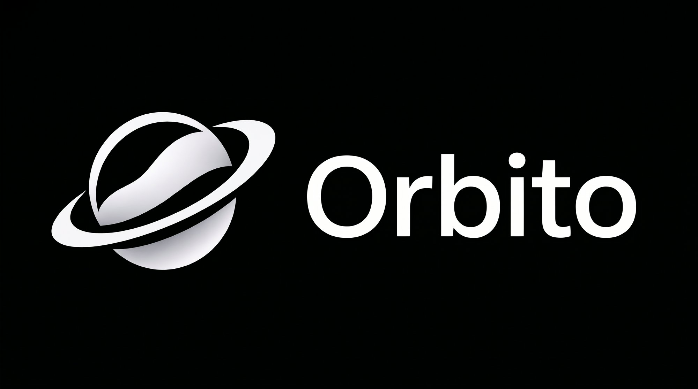

<p align="center">
  
</p>

# ORBITO

**The unified, local-first development workspace for projects, terminals, processes, and agentic workflows.**

Orbito brings your repositories, terminal processes, AI CLI providers, and multi-agent automations into a single, cohesive developer cockpit. Designed from the ground up for speed, offline privacy, and deep control over AI context.

---

[](https://github.com/ByGONCA/Orbito/actions)
[](https://github.com/ByGONCA/Orbito)
[](https://www.electronjs.org/)
[](https://react.dev/)
[](https://www.typescriptlang.org/)
[](https://github.com/ByGONCA/Orbito)
[](https://github.com/ByGONCA/Orbito/pulls)

---

## About Orbito

Modern software engineering with AI is fragmented. Developers juggle disjointed CLI tools, multiplexed terminal windows, separate code editors, and fragile copy-paste workflows. Context windows fill with irrelevant files, local changes risk getting overwritten by autonomous scripts, and proprietary code is often leaked to unvetted cloud endpoints without oversight.

**Orbito** solves this fragmentation by uniting your development environment under a single local-first architecture:

- **Unified Developer Cockpit:** Manage repositories, worktrees, active terminals, and model sessions side-by-side without context switching.
- **Context-Aware Intelligence:** Automatically parse syntax trees via Tree-sitter and retrieve code snippets with sub-millisecond SQLite FTS5 BM25 search.
- **Air-Gapped Privacy:** Run fully local models through Ollama with zero external telemetry and kernel-level network isolation guardrails.
- **Safe Agent Orchestration:** Execute autonomous multi-agent pipelines in dedicated Git worktrees, complete with human-in-the-loop review gates and diff inspection before merging.

Whether you are debugging a microservice, running local LLMs offline, or orchestrating multi-agent refactoring pipelines, Orbito provides the tooling and safety boundaries necessary for serious engineering.

---

## Features

### Workspace & Process Control
- **Project-Centric Navigation:** Manage multiple repositories, task branches, and recent projects with an instant virtualized file tree.
- **Git Worktree Isolation:** Run parallel tasks and agent experiments in isolated Git worktrees (`.worktrees/`) without touching your working directory.
- **Unified Terminal & CLI Sessions:** High-performance terminal execution supporting PowerShell, Bash, and native PTY streams with clean process tree cleanup (`SIGTERM`/`SIGKILL`).

### Multi-Provider AI Integration
- **CLI Adapter Engine:** Native adapters for Anthropic Claude Code (`claude`), OpenAI Codex (`codex`), Google Gemini (`gemini`), and local Ollama (`ollama`).
- **Interactive Stream Parsers:** Real-time terminal streaming with ANSI handling, markdown formatting, thought tag extraction (`<thought>`), and tool invocation tracking.
- **Air-Gap Mode:** One-click enforcement of zero external network access, redirecting all requests to local model endpoints (e.g., Ollama at `http://127.0.0.1:11434`).

### Context Intelligence & Token Optimization
- **AST Symbol Extraction:** Incremental Tree-sitter WASM parser indexing functions, classes, and methods across TypeScript, JavaScript, Python, Go, and Rust.
- **Hybrid Lexical Search:** SQLite FTS5 full-text search with BM25 ranking for fast symbol and fragment lookup (< 2ms).
- **Three-Tier Freshness:** Combines cached AST chunks with live disk reads to eliminate index staleness during active editing.
- **Token Efficiency Pipeline:** Centralized prompt assembly, dynamic skill instruction leveling, and intelligent model routing to maximize context window value.

### Multi-Agent Orchestration & Automation
- **Specialist Agent DAG:** Coordinate multi-step tasks across specialized roles (Architect, Backend, Frontend, Testing, Security, Documentation).
- **Automated Verification Gates:** Independent Reviewer Agent runs linting, typechecks, and test suites on worktree branches before requesting approval.
- **Human-in-the-Loop Review Center:** Review visual diffs before approving agent changes with Manual, Supervised, and Autonomous execution modes.
- **Visual Flow Builder:** Drag-and-drop workflow canvas powered by `@xyflow/react` with 29 built-in node types (AI, Context, Logic, IO, Dev) and 10 production templates.

### Enterprise-Grade Security & Persistence
- **Dual SQLite Architecture:** Strict separation between application state (`app.sqlite`) and code search indices (`index.sqlite`) with WAL mode.
- **Credential Protection:** API keys and sensitive tokens are encrypted using operating-system-level keychains (`safeStorage`).
- **OS-Level Extension Sandboxing:** Untrusted extensions run in isolated subprocesses governed by Node.js permission models, memory quotas, and prototype tampering guards.
- **Immutable Audit Logging:** All file modifications, terminal commands, and AI executions are recorded in an append-only audit log with CSV/JSON export.

---

## Installation

### Supported Platforms

Orbito is tested across:
- **Windows:** Windows 10 / Windows 11 (x64)
- **macOS:** macOS 12 Monterey or newer (Apple Silicon & Intel x64)
- **Linux:** Ubuntu 22.04 LTS+, Debian 12+, Fedora 38+ (x64)

### Running from Source

Orbito is currently built from source. Pre-compiled standalone installers for Windows (`.exe`), macOS (`.dmg`), and Linux (`.AppImage`) will be available with upcoming tagged releases on [GitHub Releases](https://github.com/ByGONCA/Orbito/releases).

To run Orbito on your local machine, proceed to the [Development Setup](#development-setup) instructions below.

---

## Development Setup

### Prerequisites

Ensure the following dependencies are installed on your host machine:

1. **Node.js:** `v22.12.0` LTS or later (Node 22 recommended)
2. **Package Manager:** `npm` v10+
3. **Git:** `v2.30.0` or later (required for Git worktree features)
4. **C++ Native Build Toolchain:**
   - **Windows:** Visual Studio Build Tools (C++ workload) or `windows-build-tools`
   - **macOS:** Xcode Command Line Tools (`xcode-select --install`)
   - **Linux:** `build-essential`, `python3`, `libsqlite3-dev`
5. *(Optional)* **AI CLI Tools & Local Models:**
   - Anthropic Claude Code CLI (`claude` on `PATH`)
   - OpenAI Codex CLI (`codex` on `PATH`)
   - Google Gemini CLI (`gemini` on `PATH`)
   - Ollama for local execution (`http://127.0.0.1:11434`)

### Setup Instructions

```bash
# 1. Clone the repository
git clone https://github.com/ByGONCA/Orbito.git
cd Orbito

# 2. Install dependencies and compile native SQLite bindings for Electron
npm install

# 3. Launch the application in development mode
npm run dev
```

### Key Development Commands

| Command | Description |
|---|---|
| `npm run dev` | Starts Vite dev servers and launches the Electron application with HMR. |
| `npm run build` | Compiles production assets for Main, Preload, and Renderer into `out/`. |
| `npm start` | Previews the production build via `electron-vite preview`. |
| `npm test` | Runs the full automated test suite inside Electron's Node runtime. |
| `npm run test:host` | Runs tests on the host Node runtime via Vitest. |
| `npm run typecheck` | Validates TypeScript types across both Node (Main/Preload) and Web (Renderer). |
| `npm run lint` | Runs ESLint across TypeScript and React source files. |
| `npm run format` | Formats all code files using Prettier. |
| `npm run postinstall` | Rebuilds `better-sqlite3` native binaries against Electron's ABI. |

---

## Project Structure

```text
Orbito/
├── .github/
│   ├── assets/                # Logos, banners, and brand assets
│   ├── workflows/             # CI matrix workflows (Windows, macOS, Linux)
│   └── FUNDING.yml            # Project sponsorship configuration
├── docs/                      # Architectural designs, security models, PRD, and reports
├── scripts/
│   └── run-electron-tests.js  # Cross-platform Electron runtime test runner for Vitest
├── src/
│   ├── main/                  # Electron Main Process (Node.js)
│   │   ├── agents/            # Multi-agent coordinator DAG, worktrees, and reviewer gates
│   │   ├── cli/               # Process engine and CLI adapters (Claude, Codex, Gemini, Ollama)
│   │   ├── context/           # Tree-sitter WASM parser, FTS5 indexer, and context assembler
│   │   ├── db/                # SQLite persistence (app.sqlite & index.sqlite) via Drizzle ORM
│   │   ├── extensions/        # Extension security engine and OS process isolation
│   │   ├── ipc/               # Typed IPC contracts with Zod schema validation
│   │   ├── prompt/            # Token optimization pipeline and model routing
│   │   ├── services/          # Security kernel, AirGapManager, and immutable audit logs
│   │   ├── skills/            # Capability registry and 10 built-in skills
│   │   └── workflows/         # Visual Flow Builder execution engine and expression evaluator
│   ├── preload/               # Secure contextBridge exposure (window.api)
│   ├── renderer/              # React 19 Frontend (Chromium Sandbox)
│   │   └── src/
│   │       ├── components/    # UI workspaces (Agents, Flows, FileExplorer, ContextInspector)
│   │       ├── stores/        # Zustand application state management
│   │       └── utils/         # UI helpers, devicons, and theme definitions
│   └── shared/                # Shared TypeScript definitions, schemas, and IPC contracts
└── tests/                     # 40+ unit, integration, and security test suites
```

---

## Roadmap

The core local-first engine and workspace (Phases 1 through 8) are fully implemented and verified. Future planned milestones include:

- [ ] **Packaged Binary Releases:** Automated GitHub Release builds offering one-click installers for Windows (`.exe` NSIS / portable), macOS (`.dmg` Universal), and Linux (`.AppImage` / `.deb`).
- [ ] **Community Extension Marketplace:** Decentralized package discovery and one-click installation for community-contributed skills and custom Flow nodes.
- [ ] **Language Server Protocol (LSP) Bridge:** Direct integration with language servers for real-time diagnostics, go-to-definition, and symbol navigation inside the editor.
- [ ] **Headless CLI & CI Automation:** Execute Orbito visual workflows and multi-agent verification checks in headless continuous integration pipelines.
- [ ] **Distributed Multi-Machine Agent Mesh:** Secure peer-to-peer delegation of heavy agent tasks to dedicated local or remote compute nodes.

---

## Contributing

Contributions to Orbito are welcome. As an open-source project, we value high-quality bug reports, documentation enhancements, feature proposals, and code contributions.

### How to Contribute

1. **Fork the Repository:** Create your own fork on GitHub.
2. **Create a Topic Branch:** Create a branch for your feature or fix (`git checkout -b feature/my-feature`).
3. **Follow Project Principles:**
   - Keep implementations minimal, robust, and clean. Reuse existing utilities and dependencies.
   - Maintain strict IPC boundaries: never expose raw Node.js modules directly to the renderer.
   - Respect anti-boxiness and clean typography UI guidelines (avoid redundant pill containers and heavy card borders).
4. **Verify Locally:**
   - Run `npm run typecheck` to ensure there are no TypeScript errors.
   - Run `npm test` to verify that all test suites pass cleanly.
5. **Commit and Push:** Write clear, conventional commit messages (`feat: ...`, `fix: ...`, `docs: ...`).
6. **Open a Pull Request:** Submit your pull request to the `master` branch with a clear description of your changes and test results.

---

## Community

- **Issue Tracker:** Report bugs or suggest feature enhancements via [GitHub Issues](https://github.com/ByGONCA/Orbito/issues).
- **Discussions:** Ask architectural questions, share workflow templates, and collaborate on [GitHub Discussions](https://github.com/ByGONCA/Orbito/discussions).
- **Repository:** Explore and star the codebase on [GitHub](https://github.com/ByGONCA/Orbito).

---

## Support the Project

Orbito is free and open-source software built for the developer community. If Orbito helps streamline your workflow and you would like to support ongoing development, voluntary contributions are greatly appreciated:

<p align="center">
  <a href="https://ko-fi.com/baptista" target="_blank">
    
  </a>
</p>

<p align="center">
  <a href="https://ko-fi.com/baptista" target="_blank">
    
  </a>
</p>

*Support is completely voluntary and goes directly toward maintaining and advancing open-source development.*

---

## License

This project is licensed under the [MIT License](https://github.com/ByGONCA/Orbito), as declared in `package.json`.
