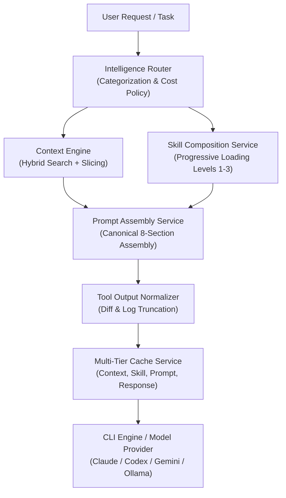

# Token Optimization Engine — AI Workspace

## Overview

The **Token Optimization Engine** in AI Workspace delivers significant reductions in token consumption, context bloat, and inference costs without degrading code quality, safety boundaries, or agent execution accuracy.

Rather than relying on lossy text compression or naive prompt truncation, the engine employs a multi-tiered, intelligence-driven architecture that acts across all layers of the application:
1. **Intelligent Context Engine**: Relevance-based fragment ranking, import relationship slicing, line-range pruning, and content-based deduplication.
2. **Skills Progressive Loading**: Multi-level skill instruction delivery (Metadata, Operational Summary, Full Specification) with multi-skill conflict resolution.
3. **Centralized Prompt Assembly**: Canonical 8-section layout, semantic whitespace compression, cross-section clause deduplication, and budget-governed section trimming.
4. **Intelligent Model Routing**: Task-complexity categorization, capability matching, cost-budget enforcement, and strict Air-Gap local model routing.
5. **Multi-Tier Caching**: LRU caches for AST context fragments, skill definitions, assembled prompts, and deterministic model responses with automated file-invalidation.
6. **Tool Output Normalization**: ANSI stripping, error highlight extraction, and head/tail line preservation for terminal outputs and unified git diffs.

---

## Token Reduction Architecture

---

## Core Optimization Mechanisms

### 1. Semantic Whitespace & Formatting Compression
Source code, markdown fragments, and system prompts frequently contain redundant consecutive blank lines, trailing spaces, and markdown table padding that inflate BPE token counts by 15% to 35%.

`PromptAssemblyService.compressWhitespace(text)` enforces:
- **Code Blocks**: Preserves indentation and syntactic structure while collapsing 3+ consecutive newlines to at most 2.
- **Prose & Prompts**: Trims per-line trailing whitespace and limits consecutive line breaks to standard paragraphs.
- **Impact**: Consistently yields 12–25% token savings on large context injections without altering code semantics.

### 2. Progressive Skill Loading (3 Levels)
Previously, each active skill injected its entire markdown instruction manual (~400 tokens per skill) into the system prompt. When an agent invoked multiple skills, instructions alone consumed 1,200–2,000 tokens before any context or task details were added.

`SkillCompositionService` introduces three progressive levels:
- **Level 1 (`metadata`)**: Skill identifier, display name, and one-sentence purpose (~12 tokens per skill). Used for initial agent triage and broad dispatching.
- **Level 2 (`summary`)**: Built-in operational summary detailing core capabilities, required tools, and output schemas (~35–45 tokens per skill). Achieves **88–92% token reduction** while giving the model complete operational guidance.
- **Level 3 (`full`)**: Complete markdown specification including extensive examples, methodology guidelines, and edge-case checklists (~400 tokens). Loaded only when deep specialized reasoning is explicitly necessary.

### 3. Cross-Section Deduplication
When multiple skills, context files, and system prompts are combined, generic advice (e.g., "Follow clean code principles", "Do not modify unrelated files", "Adhere to TypeScript best practices") is frequently repeated.

The engine maintains a normalized clause index:
- Identifies repeated semantic statements across sections.
- Retains the primary statement in the highest-priority section (System or Security).
- Eliminates duplicate occurrences from lower-priority sections (Skills, Context, Format).
- Measures and reports `deduplicationSavingsTokens` in the assembly metadata.

### 4. Multi-Tier Intelligent Caching & Security Boundary
`MultiTierCacheService` provides four specialized LRU caches:
1. **Context Cache** (Capacity: 1,000 entries, TTL: 30 min): Caches parsed AST symbols, import trees, and search results.
2. **Skill Cache** (Capacity: 200 entries, TTL: 60 min): Caches composed and deduplicated multi-skill instruction blocks.
3. **Prompt Cache** (Capacity: 500 entries, TTL: 15 min): Caches assembled prompt structures keyed by SHA-256 fingerprint.
4. **Model Response Cache** (Capacity: 300 entries, TTL: 60 min): Caches responses for pure, deterministic read-only operations (`classification`, `summarization`, `code-explanation`).

#### Cache Invalidation, Workspace Isolation & Safety
- **Cross-Workspace Isolation**: Model response cache keys (`buildModelResponseKey`) strictly bind the normalized `workspacePath`, preventing cache pollution across different repositories.
- **Permission Tier Binding**: Cache keys bind the caller's active permission tier (`read_only`, `standard`, `elevated`, `admin`). Elevating permissions invalidates prior lower-tier entries via `onPermissionTierChanged`.
- **Air-Gap Boundary**: Toggling Air-Gap mode (`onAirGapToggled`) immediately purges model response and prompt caches to prevent remote/local data bleed.
- **Workspace File Changes**: Filesystem modification automatically purges matching entries from context, prompt, and model caches via `onFileModified(filePath, workspacePath)`.
- **Secret Protection**: Inputs containing API keys, bearer tokens, passwords, or private keys are categorically ineligible for caching.
- **Stateful Mutation Prohibition**: Any modifying commands (`isModifying: true`, destructive keywords, file writes, git commits) or calls with `temperature > 0` bypass the response cache completely.

### 5. Tool Output Normalization & Balanced Multi-File Diffs
Terminal commands, test runners, and unified git diffs can easily generate thousands of tokens of redundant log noise.

`ToolOutputNormalizer` processes raw outputs:
- **ANSI Stripping**: Strips terminal escape codes (`\u001b[...]`).
- **Error Extraction**: Automatically scans for error patterns (`Error:`, `Fatal:`, `panic:`, `TypeError:`, stack traces) and hoists them into a `--- [DETECTED ERROR HIGHLIGHTS] ---` header.
- **Head/Tail Truncation**: Retains 35% of the line budget at the head (invoking command and setup) and 65% at the tail (failure location and exit code), truncating intermediate loops.
- **Raw Audit Store**: Full un-truncated logs are stored in a bounded in-memory audit store and retrievable via `ToolOutputNormalizer.getRawOutput(rawOutputId)`.
- **Balanced Multi-File Diff Preservation**: `normalizeDiff` segments diffs across all modified files, allocating proportional line budgets to each file block so no single file starves others of change context.
- **Savings**: Yields 50–75% token reduction on verbose command failures.

---

## Token Analytics & Accounting

All token consumption is tracked and distinguished across three mechanisms:
1. **Model-Aware BPE Tokenization**: Computed via `js-tiktoken` using `o200k_base` for GPT-4o / GPT-4o-mini and `cl100k_base` for legacy OpenAI/embeddings, with calibrated multipliers for Claude (~1.06x) and Gemini (~0.96x). Every evaluation reports explicit method and confidence metadata (`exact_bpe`, `calibrated_estimate`, `heuristic_estimate`).
2. **Estimated Tokens**: Fast character-ratio calculation (`Math.ceil(chars / 4)`) used for pre-flight budgeting.
3. **Provider Reported Tokens & Reconciliation**: Actual usage reported in provider completions headers is recorded into `AnalyticsService` and reconciled with local estimates via `reconcileWithProviderUsage`.

The `AnalyticsService` persists:
- `cacheHits` & `cacheTokensSaved`: Zero-token executions serviced directly from LRU tiers.
- `deduplicationTokensSaved`: Tokens saved by clause deduplication.
- `compressionTokensSaved`: Tokens saved by semantic whitespace compression and tool normalization.
