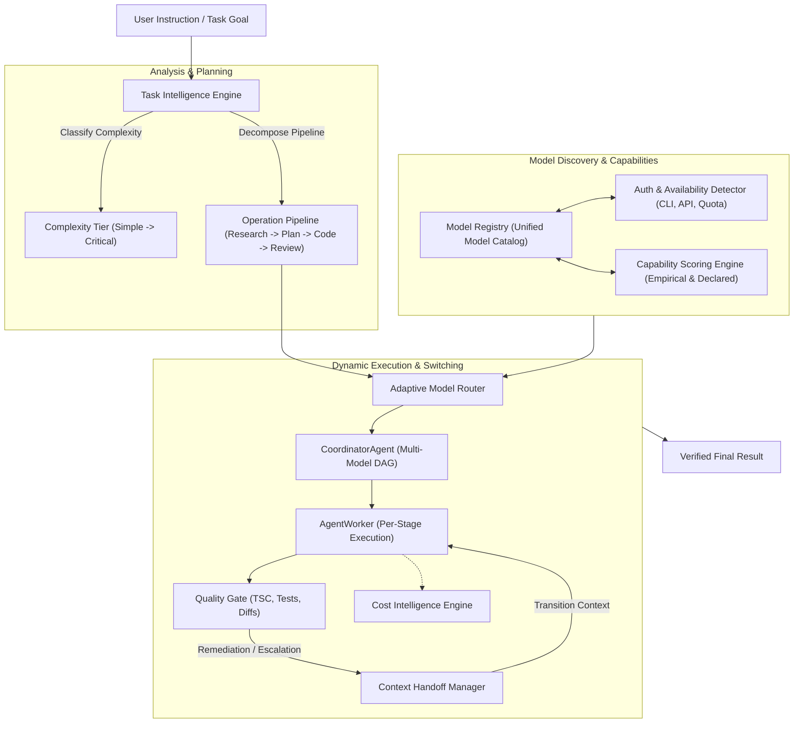

# Adaptive Intelligence Specification & System Architecture

## 1. System Overview & Philosophy

**Orbito Adaptive Intelligence** is the cognitive execution layer of Orbito. It bridges user goals, specialist agents, and individual AI models.

### The Guiding Principle
```
Model-first. Provider-aware. Subscription-aware. Capability-driven. Cost-conscious. Quality-oriented.
```

- **Model-First**: Models are the fundamental unit of intelligence. A provider is merely an execution transport.
- **Provider-Aware**: Operates seamlessly for single-provider users (optimizing across that provider's models) and multi-provider users (comparing across providers).
- **Subscription-Aware**: Distinguishes publicly cataloged models from models the user is authenticated and authorized to execute.
- **Capability-Driven**: Evaluates models based on empirical benchmarks across reasoning, coding, tool execution, and context size.
- **Cost-Conscious**: Selects the least expensive model capable of delivering the required quality for each individual operation.
- **Quality-Oriented**: Enforces deterministic quality gates (compiler, test suites, diff analysis) and escalates to frontier models when needed.

---

## 2. Core Architecture Pipeline



---

## 3. Component Specifications

### 3.1 Model Intelligence Registry (`src/main/ai/model-registry.ts`)
The registry maintains real metadata for all recognized models across official providers (`anthropic`, `openai`, `gemini`, `ollama`, `openrouter`, etc.):
- **Model Record Structure**:
  - `id`: Internal unique identifier (e.g. `anthropic:claude-3-7-sonnet`).
  - `provider`: Underlying CLI provider.
  - `modelId`: Official provider string passed to the CLI/API.
  - `displayName`: Human-friendly label.
  - `family`: Model family group (`claude-sonnet`, `claude-haiku`, `gpt-4o`, `gemini-pro`, etc.).
  - `contextWindow`: Maximum input tokens.
  - `maxOutputTokens`: Maximum completion tokens.
  - `pricing`: `{ inRate: number; outRate: number; cachedInRate?: number }` (USD per 1M tokens).
  - `availability`: `'available' | 'unauthenticated' | 'not_installed' | 'quota_exceeded'`.
  - `capabilities`: Evidence-based ratings (0-100) across 8 cognitive axes.

### 3.2 Capability Evaluation Engine (`src/main/ai/model-capability-engine.ts`)
Evaluates model fitness against required task operations:
1. `reasoning`: Multi-step deductive logic, architectural planning.
2. `coding`: Type-safe syntax, idiomatic design, refactoring precision.
3. `debugging`: Root-cause isolation, error traceback comprehension.
4. `architecture`: System topology, decoupling, boundary defense.
5. `research`: Literature search, synthesis, factual recall.
6. `classification`: Fast categorization, schema validation, intent matching.
7. `tool_use`: MCP tool calling, argument precision, structured execution.
8. `long_context`: Document understanding across 100k+ tokens.

### 3.3 Task Intelligence Engine (`src/main/ai/task-intelligence-engine.ts`)
Inspects user instructions and project files before execution:
- Computes estimated input tokens and filesystem mutation risks.
- Determines task complexity tier (`simple`, `routine`, `intermediate`, `complex`, `critical`).
- Decomposes tasks into a sequence of capability requirements.

### 3.4 Adaptive Model Router (`src/main/ai/adaptive-model-router.ts`)
Selects models dynamically under 3 operating modes:
- **Manual Mode**: User pins model; router only recommends alternatives.
- **Adaptive Mode**: Router chooses the optimal model per stage based on capability and cost.
- **Advanced Orchestration Mode**: Router coordinates multi-model DAGs, parallel worktrees, and cross-model reviews.

### 3.5 Context Handoff Manager (`src/main/ai/model-context-handoff.ts`)
Preserves execution state when switching models without prompt bloat:
- Bundles goal, stage summaries, architectural invariants, file diffs, tool outputs, and outstanding actions into a clean, normalized handoff package.
- Detects and prevents circular switching loops.

### 3.6 Execution Quality Evaluator (`src/main/ai/model-evaluation-engine.ts`)
Validates stage outcomes using deterministic gates:
- Runs TypeScript compiler check (`tsc --noEmit`).
- Runs unit tests when test files are touched.
- Inspects Git diffs for unintended deletions or contract violations.
- Triggers escalation to higher-tier models if a lower-tier model struggles with remediation.

### 3.7 Cost & Token Intelligence Engine (`src/main/ai/model-cost-engine.ts`)
Tracks resource consumption across exact, estimated, and unknown categories:
- Computes costs based on Tiktoken BPE counts and published model pricing.
- Enforces per-task, per-project, and switch count budgets.
- Requests human approval before exceeding budget thresholds.

---

## 4. Single-Provider vs. Multi-Provider Guarantee

Orbito guarantees that **users with only one provider are first-class citizens**:
- If a user only has Claude configured, the router optimizes between Haiku (fast classification), Sonnet (implementation), and Opus/Sonnet-Thinking (architecture). It never asks for or introduces another provider.
- If a user has OpenAI configured, it optimizes between GPT-4o-mini, GPT-4o, and o3-mini.
- If a user has multiple providers, the router evaluates eligible models across all configured providers.
