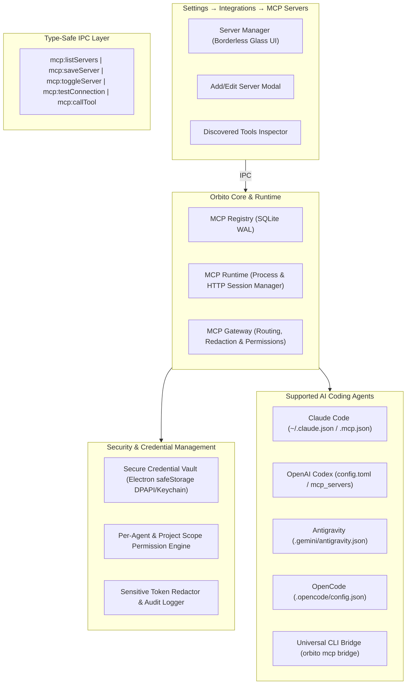

# Centralized Model Context Protocol (MCP) Infrastructure

## 1. Overview & Core Objective
Orbito's Centralized Model Context Protocol (MCP) infrastructure enables users to configure external tool servers, credentials, and access permissions **once** in Orbito, making them securely available to every compatible AI coding agent (Claude Code, OpenAI Codex, Antigravity, OpenCode, Cursor, and others) without requiring users to configure and authenticate the same integration repeatedly.



---

## 2. Shared Data Models & Contracts (`src/shared/mcp.ts`)

### Transport Types
- `stdio`: Spawns local child processes (e.g. `npx`, `node`, `uvx`, `docker`, binary executables).
- `streamable_http`: Connects to remote MCP endpoints via HTTP Server-Sent Events (SSE).
- `sse`: Backwards-compatible alias for streamable HTTP.

### Server Status Lifecycle
- `disconnected`: Server is registered but idle or disabled.
- `connecting`: Spawning child process or establishing HTTP handshake.
- `connected`: Active JSON-RPC 2.0 session established; tools discovered and ready.
- `error`: Process crashed or connection timed out; diagnostic error logged.
- `auth_required`: Missing or expired API key / OAuth token.

---

## 3. Database Schema (`src/main/db/database.service.ts`)

### `mcp_servers` Table
```sql
CREATE TABLE IF NOT EXISTS mcp_servers (
  id TEXT PRIMARY KEY,
  name TEXT NOT NULL UNIQUE,
  description TEXT DEFAULT '',
  transport TEXT NOT NULL,
  command TEXT,
  args_json TEXT DEFAULT '[]',
  env_keys_json TEXT DEFAULT '[]',
  url TEXT,
  enabled INTEGER NOT NULL DEFAULT 1,
  status TEXT NOT NULL DEFAULT 'disconnected',
  error_message TEXT,
  tools_cache_json TEXT DEFAULT '[]',
  auth_type TEXT NOT NULL DEFAULT 'none',
  auth_config_json TEXT DEFAULT '{}',
  agent_permissions_json TEXT DEFAULT '{"all":true,"allowedAgents":[]}',
  project_scope TEXT,
  auto_reconnect INTEGER NOT NULL DEFAULT 1,
  created_at INTEGER NOT NULL,
  updated_at INTEGER NOT NULL
);
CREATE INDEX IF NOT EXISTS idx_mcp_servers_enabled ON mcp_servers(enabled);
CREATE INDEX IF NOT EXISTS idx_mcp_servers_project ON mcp_servers(project_scope);
```

### `mcp_audit_logs` Table
```sql
CREATE TABLE IF NOT EXISTS mcp_audit_logs (
  id TEXT PRIMARY KEY,
  server_id TEXT NOT NULL,
  server_name TEXT NOT NULL,
  tool_name TEXT NOT NULL,
  agent_id TEXT DEFAULT 'system',
  status TEXT NOT NULL,
  duration_ms INTEGER DEFAULT 0,
  timestamp INTEGER NOT NULL,
  error_message TEXT
);
CREATE INDEX IF NOT EXISTS idx_mcp_audit_server ON mcp_audit_logs(server_id);
CREATE INDEX IF NOT EXISTS idx_mcp_audit_timestamp ON mcp_audit_logs(timestamp);
```

---

## 4. Security Architecture & Credential Vault

### Fail-Closed OS Keychain Encryption
Environment variables (`mcp:env:${serverId}:${varName}`) and authentication tokens (`mcp:auth:${serverId}:token`) are stored in SQLite strictly encrypted via Electron's `safeStorage`:
- Windows: Windows Data Protection API (DPAPI)
- macOS: Apple Keychain Services
- Linux: Secret Service API / libsecret

If OS keychain encryption is unavailable, the vault **fails closed**, refusing to persist credentials in plaintext.

### Secret Redaction Engine (`src/main/mcp/security/secret-redactor.ts`)
Before emitting logs, IPC payloads, or responses, text is sanitized:
1. Dynamically registered secrets from active vaults are scrubbed (`••••••••`).
2. Regex heuristics scrub Bearer headers, OpenAI (`sk-...`), GitHub (`ghp_...`), and Slack tokens.
3. Structured JSON objects are traversed recursively to mask secret fields.

### Authorization & Scope Boundaries (`src/main/mcp/security/mcp-permission-manager.ts`)
- **Server State**: Disabled servers immediately reject all incoming tool invocations.
- **Agent Permissions**: Servers can be designated for all agents or restricted to an approved list (e.g., Claude Code and Antigravity only).
- **Project Isolation**: Servers bound to a specific `projectScope` cannot be accessed by requests originating from another project.

---

## 5. Agent Delivery & Universal CLI Bridge

### Native Configuration Reconciliation
Orbito provides specialized adapters that reconcile local agent configuration files:
- **Claude Code**: Merges managed servers into `.mcp.json` or `~/.claude.json` with `_orbitoManaged: true`, leaving user-native servers untouched.
- **OpenAI Codex**: Reconciles `.codex/mcp.json`.
- **Antigravity**: Reconciles `.gemini/antigravity-mcp.json`.
- **OpenCode**: Reconciles `.opencode/mcp.json`.

### Universal CLI Bridge (`bin/orbito.js mcp bridge`)
For any external agent or CLI that supports stdio MCP:
```bash
node bin/orbito.js mcp bridge --agent claude
```
The bridge runs a stdio JSON-RPC 2.0 loop, routing `tools/list` and `tools/call` directly to Orbito's Central Gateway with full permission enforcement and audit logging.

---

## 6. User Experience & Design Compliance
Located in **Settings → Integrations → MCP Servers**:
- Adheres to Orbito's **Anti-Boxiness Principle** and **Strict Invariant: ZERO WHITE BORDERS**.
- Borderless floating cards (`border-0`, `bg-white/[0.02]`).
- Metrics displayed with clean typography without boxed pill backgrounds on counts.
- Icon-only toolbar controls with accessible tooltips (`title` and `aria-label`).
- Real-time status indicators (green connected, amber pulse connecting, red error, gray disconnected).
- Discovered tool inspection with argument schemas and parameter definitions.
