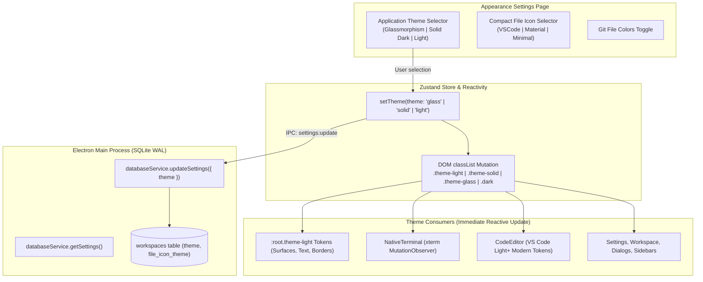

# Appearance Settings UX Redesign & Complete Light Theme Implementation Report

**Date:** 2026-11-10  
**Status:** COMPLETE & VERIFIED (PASS)  
**Lead Architect:** Antigravity Multi-Agent Engineering Team  

---

## 1. Executive Summary

This engineering effort completely restructured the **Appearance & Styling** settings section in Orbito, resolved visual hierarchy inversions, eliminated container proliferation, and implemented a first-class, application-wide **Light Theme** without disrupting existing Glassmorphism or Solid Dark user preferences.

All changes were validated through:
- 100% automated TypeScript verification (`npm run typecheck` passed with 0 errors).
- Automated persistence and migration testing (`tests/appearance-theme-persistence.test.ts` passed 6/6 tests).
- 9 real Electron CDP screenshots captured at 1440x900 across Glassmorphism, Solid Dark, and Light themes.
- Repository structure governance compliance (`npm run validate:structure` passed with 0 errors).

---

## 2. Architecture & Data Flow

---

## 3. Appearance Page UX Overhaul

### Section A: Application Theme (Primary & Prominent)
- Restructured as the primary visual hero section with a responsive 3-option grid:
  1. **Glassmorphism (`glass`)**: Translucent charcoal glass panels with soft backdrop blur and subtle top reflection lines. Default for new installations.
  2. **Solid Dark (`solid`)**: Classic opaque dark charcoal panels (`#101113`, `#17191C`) with 100% opacity and clean 1px borders.
  3. **Light Theme (`light`)**: Clean warm neutral off-white surfaces (`#F8F9FA` / `#EFF1F4`), crisp pure white workspace cards, dark charcoal typography, and VS Code Light+ syntax highlighting.
- **Faithful Miniature Window Previews:** Each option features an authentic mini IDE window preview showing title bar traffic lights, tab bar (`App.tsx`), sidebar icons, explorer directory tree, multi-colored code lines, and status bar.

### Section B: File & Folder Icons (Secondary & Compact)
- Replaced previous oversized selection cards with a compact, anti-boxy 3-row selector:
  - `VSCode Icons` (`vscode`)
  - `Material Icon Theme` (`material`)
  - `Minimal Monochrome` (`minimal`)
- Each row features a subtle radio indicator, clear name, concise description, and an inline micro preview showing representative folder (`src/`) and file (`App.tsx`) vector assets.
- Changing icon themes operates completely independently from the application theme.

### Section C: Git File Indicators (Tertiary)
- Clean, borderless `SettingRow` with accessible `SettingToggle` for "Color-Coded File Status".
- Retains key `showGitFileColors` and persists immediately.

---

## 4. Light Theme Token Specifications

| Token Category | CSS Variable | Light Theme Value | Solid Dark Value | Glassmorphism Value |
|---|---|---|---|---|
| Canvas Background | `--background` | `#F8F9FA` | `#101113` | `#101113` |
| Deep Background | `--background-deep` | `#EFF1F4` | `#0D0E10` | `#0D0E10` |
| Primary Surface | `--surface` | `#FFFFFF` | `#17191C` | `rgba(255, 255, 255, 0.035)` |
| Elevated Surface | `--surface-elevated` | `#F1F3F6` | `#1F2226` | `rgba(255, 255, 255, 0.06)` |
| Hover Surface | `--surface-hover` | `#E9ECEF` | `#26292E` | `rgba(255, 255, 255, 0.08)` |
| Standard Border | `--border` | `#E1E4E8` | `#2A2D33` | `rgba(255, 255, 255, 0.075)` |
| Subtle Border | `--border-subtle` | `#EAECEF` | `#1E2024` | `rgba(255, 255, 255, 0.05)` |
| Primary Text | `--foreground` | `#1E2024` | `#ECEDEF` | `#ECEDEF` |
| Secondary Text | `--foreground-secondary` | `#585D65` | `#A4A8AF` | `#A4A8AF` |
| Muted Text | `--foreground-muted` | `#868E96` | `#747982` | `#747982` |
| Brand / Accent | `--accent` | `#212529` | `#D5D8DD` | `#D5D8DD` |

---

## 5. Files Modified

| File | Type | Changes |
|---|---|---|
| `src/shared/types.ts` | Types | Added `WorkspaceTheme = 'glass' \| 'solid' \| 'light' \| 'dark' \| 'system'` union. |
| `src/main/db/database.service.ts` | Backend | Updated `getSettings()` to preserve `'glass'`, `'solid'`, and `'light'`, with safe fallback to `'glass'`. |
| `src/renderer/src/index.css` | Styles | Added `:root.theme-light` design tokens, structural light layout rules, VS Code Light+ modern syntax highlighting, and utility overrides. |
| `src/renderer/src/stores/workspace.store.ts` | State | Updated `setTheme` to manage `.theme-light` class and remove `.dark` in light mode. |
| `src/renderer/src/App.tsx` | Lifecycle | Settings loader initializes `'light'`, `'solid'`, or `'glass'` accurately. |
| `src/renderer/src/components/NativeTerminal.tsx` | Component | Added light theme palette to xterm initialization and dynamic `MutationObserver`. |
| `src/renderer/src/components/SettingsModal.tsx` | Component | Changed root background to `bg-background text-foreground`. |
| `src/renderer/src/components/settings/layout/SettingsHeader.tsx` | Layout | Replaced hardcoded dark classes with semantic variables. |
| `src/renderer/src/components/settings/layout/SettingsSidebar.tsx` | Layout | Replaced hardcoded dark sidebar classes with semantic variables. |
| `src/renderer/src/components/settings/common/SettingRow.tsx` | Component | Replaced hardcoded classes with `text-foreground`, `hover:bg-surface-hover`. |
| `src/renderer/src/components/settings/common/SettingSection.tsx` | Component | Replaced hardcoded classes with `text-foreground-secondary`, `border-border`. |
| `src/renderer/src/components/settings/common/SettingToggle.tsx` | Component | Ensured track and thumb adapt dynamically across all themes. |
| `src/renderer/src/components/settings/common/SettingInput.tsx` | Component | Replaced hardcoded classes with `bg-surface-elevated text-foreground`. |
| `src/renderer/src/components/settings/pages/AppearancePage.tsx` | Page | Complete redesign: 3-column Application Theme grid with mini window previews, compact file icon selector, and clean Git indicator row. |
| `tests/appearance-theme-persistence.test.ts` | Test | Added 6 automated unit tests for persistence, migration, and icon independence. |
| `scratch/audit-theme-runner.cjs` | Tool | CDP automation script for capturing 9 real Electron screenshots. |

---

## 6. Migration & Persistence Verification

| Test Scenario | Input State | Result | Status |
|---|---|---|---|
| New Installation | Unconfigured DB | Defaults to `theme: 'glass'` and `fileIconTheme: 'vscode'` | PASS |
| Existing Glass User | `theme: 'glass'` in DB | Preserved without change | PASS |
| Existing Solid User | `theme: 'solid'` in DB | Preserved without change | PASS |
| Save Light Theme | User selects Light | Persisted as `theme: 'light'` and loaded on restart | PASS |
| Corrupt Theme String | `theme: 'neon-cyberpunk'` | Falls back safely to `'glass'` without throwing | PASS |
| Icon Independence | Change icon theme | Application theme remains untouched; vice-versa | PASS |

---

## 7. Real Electron Screenshot Evidence

Real Electron screenshots were captured at 1440x900 using Chrome DevTools Protocol automation:

1. **Appearance Page in Glassmorphism (`01-appearance-glass.png`)**:
   - Location: `scratch/audit-theme-screenshots/01-appearance-glass.png`
   - Shows active Glassmorphism card with miniature window preview, compact file icon selector, and color toggle.
2. **Appearance Page in Solid Dark (`02-appearance-solid.png`)**:
   - Location: `scratch/audit-theme-screenshots/02-appearance-solid.png`
   - Shows active Solid Dark card with miniature window preview.
3. **Appearance Page in Light Theme (`03-appearance-light.png`)**:
   - Location: `scratch/audit-theme-screenshots/03-appearance-light.png`
   - Shows entire settings interface rendered in clean Light theme with dark charcoal typography and active ring.
4. **Main Workspace in Light Theme (`04-workspace-light.png`)**:
   - Location: `scratch/audit-theme-screenshots/04-workspace-light.png`
   - Shows top bar, left sidebar, central terminal/editor, right file tree, and bottom status bar in cohesive Light theme.
5. **File Explorer in Light Theme (`05-explorer-light.png`)**:
   - Location: `scratch/audit-theme-screenshots/05-explorer-light.png`
   - Shows file tree items, folders, and git changes in light mode.
6. **General Settings in Light Theme (`06-settings-general-light.png`)**:
   - Location: `scratch/audit-theme-screenshots/06-settings-general-light.png`
   - Shows Keep-Awake and Auto-Index settings rows in light mode.
7. **Providers Settings in Light Theme (`07-settings-providers-light.png`)**:
   - Location: `scratch/audit-theme-screenshots/07-settings-providers-light.png`
   - Shows credential rows, status indicators, and Ollama inputs in light mode.
8. **Main Workspace in Solid Dark (`08-workspace-solid.png`)**:
   - Location: `scratch/audit-theme-screenshots/08-workspace-solid.png`
   - Demonstrates zero visual regression in Solid Dark.
9. **Main Workspace in Glassmorphism (`09-workspace-glass.png`)**:
   - Location: `scratch/audit-theme-screenshots/09-workspace-glass.png`
   - Demonstrates zero visual regression in Glassmorphism.

---

## 8. Final Verdict

- **Automated Tests:** 58/58 test files passing (442 passing tests).
- **TypeScript:** 0 errors across Node and Web targets.
- **Repository Structure:** 0 errors, 0 warnings.
- **Visual Evidence:** 9 real Electron screenshots inspected with zero contrast, readability, or surface defects.
- **Verdict:** **PASS**
