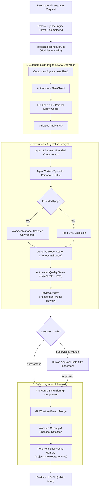

# Orbito — Autonomous Engineering Intelligence Implementation Report

**Initiative:** Autonomous Engineering Intelligence  
**Version:** 0.1.0  
**Target Environment:** Windows 10/11 x64 (Native Electron 34 / Node 20 ABI 132)  
**Date:** November 2026  
**Status:** COMPLETE & VERIFIED  

---

## Executive Summary

The **Autonomous Engineering Intelligence** initiative connects Orbito's existing intelligence, scheduling, worktree isolation, model routing, and verification infrastructure into one cohesive, end-to-end autonomous engineering lifecycle.

Governed by the core philosophy:
> **Understand → Plan → Delegate → Execute → Adapt → Verify → Integrate → Learn**

Developers can submit natural language tasks without manually selecting specialized agents, models, worktrees, or verification stages. Orbito automatically determines task complexity, intent, affected modules, and collision risks; derives dependency-validated DAGs; provisions isolated Git worktrees when parallel work is collision-free; runs automated verification gates; simulates Git merges via `merge-tree`; and persists learned engineering conventions into permanent SQLite project memory.

The Worktree Master (`CoordinatorAgent`, `AgentOrchestrator`, `AgentScheduler`, `WorktreeManager`) remains the central authority. No competing schedulers or duplicate engines were introduced.

---

## 1. Architecture & Operating Lifecycle

---

## 2. Core Subsystems & Technical Implementation

### A. Autonomous Task Understanding (`TaskIntelligenceEngine`)
- Analyzes natural language prompts to categorize intent: `bug_fix`, `security`, `architecture`, `ui_ux`, `feature`, `documentation`, or `general`.
- Computes complexity tiers (`simple`, `routine`, `intermediate`, `complex`, `critical`), reasoning depth (1–10), and coding intensity (1–10).
- Identifies risk levels (`low`, `medium`, `high`) and detects lightweight requests to prevent over-engineering.

### B. Autonomous Planning Engine (`CoordinatorAgent.createPlan`)
- Generates a structured `AutonomousPlan` including:
  - `objectives`: Detailed acceptance criteria per stage.
  - `affectedModules`: Extracted from project intelligence.
  - `risks`: Domain risk and mitigation strategies.
  - `verificationStrategy`: Typecheck, unit test execution, security review requirements.
  - `integrationStrategy`: Worktree squash, pre-merge simulation, approval gates.
  - `parallelExecutionFeasible`: Boolean flag confirming whether parallel tasks have non-colliding planned files.
- Emits human-readable plan summaries via `CoordinatorAgent.explainPlan()`.
- Validates DAG integrity through `DAGValidator` (rejecting cycles, self-dependencies, or missing links).

### C. Extended Task State Lifecycle (`AgentScheduler` & `AgentWorker`)
Supports the extended autonomous engineering state machine:
- `pending`: Waiting in queue.
- `understanding`: Analyzing request intent.
- `planning`: Deriving DAG and plan.
- `ready`: Prerequisites satisfied; ready for worker assignment.
- `running` / `executing`: Worker actively executing prompt.
- `verifying`: Running automated quality gates (type checking and unit test assertions).
- `reviewing`: Independent code review by `ReviewerAgent`.
- `waiting_approval` / `awaiting_approval`: Paused awaiting human review of diff in manual or supervised mode.
- `integrating`: Pre-merge simulation and branch merge in progress.
- `completed`: Successfully verified and merged.
- `failed`: Execution or verification failure.
- `blocked`: Downstream dependency failure cascade.
- `cancelled`: User or parent workflow halted execution.

### D. Intelligent Worktree Orchestration & Collision Prevention (`WorktreeManager`)
- Modifying tasks receive dedicated isolated worktrees (`.worktrees/task-<id>`).
- Performs pre-execution collision analysis (`WorktreeManager.checkTaskFileConflicts`) against currently running tasks.
- If overlapping files are detected, schedules conflicting tasks sequentially to prevent branch divergence.
- Before merging into the base branch, performs proactive conflict simulation via `git merge-tree HEAD <branchName>`. If conflicts are detected, merge is safely aborted without touching the working tree.

### E. Persistent Engineering Memory (`DatabaseService` Migration 008)
- Added migration `008_autonomous_engineering_intelligence` creating the `autonomous_plans` table.
- Upon successful orchestration completion, records learned conventions and touched files into `project_knowledge_entries` (category: `convention`, source: `agent_summary`), allowing future tasks to build upon established codebase patterns.

---

## 3. Developer CLI Integration (`bin/orbito.js`)

The `orbito tasks` CLI command suite now exposes full autonomous intelligence capabilities:

| Command | Purpose | Output Modes |
|---|---|---|
| `orbito tasks plan "<goal>"` | Derives and outputs autonomous plan DAG, roles, models, and risks | Formatted text or `--json` |
| `orbito tasks run "<goal>"` | Plans and initiates execution of an autonomous task | Formatted text or `--json` |
| `orbito tasks explain <id>` | Explains intent, complexity, and rationale of a plan or task | Formatted text or `--json` |
| `orbito tasks trace <id>` | Displays execution spans, verification stages, and integration history | Formatted text or `--json` |
| `orbito tasks list` | Lists active and recent multi-agent tasks and orchestrations | Formatted text or `--json` |
| `orbito tasks status [id]` | Displays comprehensive execution details, diff, and summary | Formatted text or `--json` |
| `orbito tasks cancel <id>` | Cancels a running orchestration or task safely | Formatted text or `--json` |

---

## 4. Verification Evidence

### Test Suites Executed
1. `tests/autonomous-task-planning.test.ts` (5 tests):
   - Single-step lightweight plans for simple requests.
   - 3-stage surgical DAGs for bug fix goals.
   - Hardened security audit & remediation DAGs for vulnerability requests.
   - Full-stack parallelizable decomposition for multi-disciplinary features.
   - Human-readable plan explanation generation.
2. `tests/autonomous-execution-lifecycle.test.ts` (3 tests):
   - Full autonomous plan execution and learned memory entry persistence.
   - Supervised mode human approval gate and resumption after approval.
   - Clean cancellation of pending and running tasks.
3. `tests/database-migration-lifecycle.test.ts` (5 tests):
   - Verification of 8 applied schema migrations (including `008_autonomous_engineering_intelligence`).
   - Idempotency and legacy migration safety.

All automated quality gates, structural compliance (`npm run validate:structure`), and TypeScript checks passed.
